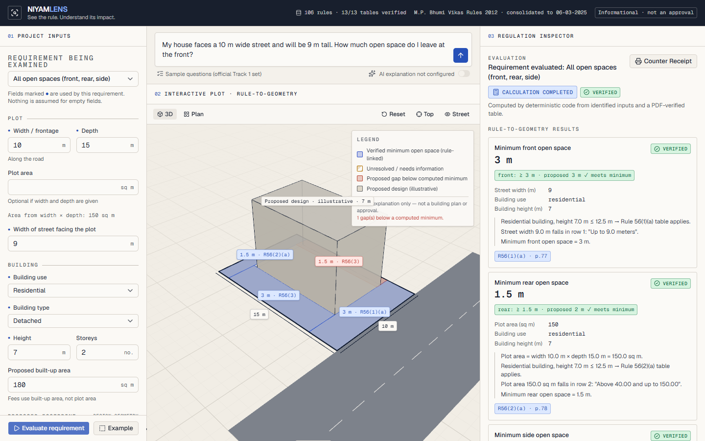
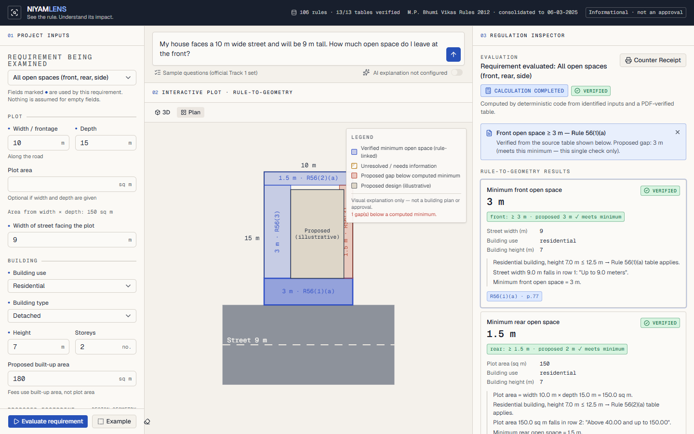

# NIYAMLENS · नियमलेंस

**Visual Building Regulation Intelligence. See the rule. Understand its impact.**

NIYAMLENS is an evidence-backed reference tool for a **building-permission clerk at the Bhopal Municipal Corporation**.
It answers questions about the **M.P. Bhumi Vikas Rules, 2012** in English or Hindi. Every answer shows:

- the rule number, the exact source passage and its PDF page;
- deterministic calculations for a small, verified set of numeric tables;
- a 3D view of the plot, where each restriction zone links to the rule behind it.

> Informational decision support only. Not an official building approval, plan sanction or legal opinion.
> Final interpretation and decisions remain with the responsible authority. Not affiliated with or endorsed by the
> Government of Madhya Pradesh, MPSeDC or the Bhopal Municipal Corporation.

| Team | Members | Track | Target user |
|---|---|---|---|
| **[TEAM NAME — to be filled]** | [MEMBER 1], [MEMBER 2], [MEMBER 3], [MEMBER 4], [MEMBER 5] | Bhopal Impact Lab 2026 · Track 1: Bhumi Vikas Sahayak | BMC building-permission counter clerk |



---

## The problem

A citizen at the counter asks: *"My plot is 200 sq m on a 9 m road. How much do I leave at the front, and what fee do I pay?"*
The answer is spread across a 108-page rulebook. The values sit in flattened tables, and several conditions apply
(building use, height, plot area, street width). The consolidated copy stops at **6 March 2025**, and the
**28 August 2026 amendment to Rule 2(5)(c)** (plots up to 500 sq m) is not in it. Questions come in Hindi and English.
The clerk needs a correct answer quickly, with the rule to show the citizen, and needs to know when the rules **do not** answer.

## Core workflow

1. The clerk types the citizen's question (English or Hindi) **or** fills in project inputs (plot, street, building).
2. NIYAMLENS extracts only the values that are stated with units. It never infers plot dimensions from plot area.
3. It retrieves the relevant rule passages from the supplied JSONL locally (BM25), with page-accurate citations.
4. When the question maps to a **verified table**, deterministic Python computes the value. If a condition such as
   height or use is unknown, it asks for it and shows the possible answers as conditional results instead.
5. The Regulation Inspector shows status, answer, calculation steps, the exact source text and the PDF page.
   The 3D plot draws the verified zones; clicking a zone opens its rule.
6. The clerk prints a **Counter Receipt** (browser print-to-PDF) or downloads it as JSON.

## Features

- **Rule-to-Geometry Engine.** Front, rear and side open-space zones are drawn **only** from deterministic results.
  Each zone is selectable and links to its rule and page in the inspector.
  - If the clerk enters a proposed footprint, each gap is compared with the computed minimum. The result reads
    "meets minimum" or "below minimum". This is a single, clearly scoped check; NIYAMLENS never says "compliant" or "approved".
  - Unresolved requirements are drawn as amber dashed edges with no dimension.
  - The building volume is labelled *illustrative*.
- **Evidence-backed answers.** Each passage carries its rule ID, sub-rule, title, PDF page and the document name.
  Pages are taken from the running headers inside the supplied text, and a test checks every passage against the page text.
- **Regulation Debugger statuses.** `VERIFIED`, `CALCULATION_COMPLETED`, `SOURCE_FOUND` (text located, not applied),
  `MORE_INFORMATION_NEEDED`, `NOT_FOUND`, `VERSION_REVIEW_NEEDED`, `ILLUSTRATIVE_ONLY`. The most cautious status is shown first.
- **"Not found in the supplied rules."** Questions outside the rules (e.g. property tax, land rates) or with no relevant
  passage return this text. No citation is shown and the AI is not called.
- **Version warning.** Questions about permission for plots ≤ 500 sq m, or that mention Rule 2(5)/Aug 2026, are flagged
  `VERSION_REVIEW_NEEDED`. The amendment is **not** merged into answers.
- **Hindi.** Hindi questions get Hindi answers, and Hindi input extraction handles वर्ग मीटर, मीटर, सड़क and similar terms.
  Answers are labelled as explanations, not quotations from the Hindi PDF. A court comment printed in the rulebook
  (under Rule 4) records that the Hindi version prevails.
- **Optional Cerebras explanation.** When `CEREBRAS_API_KEY` is set, a short explanation is generated from the retrieved
  passages and computed facts only. It is rejected, and the deterministic summary shown instead, if:
  - it is not valid JSON;
  - it cites a passage that was not supplied;
  - it contains a number that is not in the evidence.
- **Counter Receipt.** Shows the question, answer, inputs, calculation steps, status, missing information, warnings,
  supporting text with pages, the date and a fixed disclaimer.
- **Responsive and accessible.** Three panels on desktop and tabs on small screens.
  - The 3D view is lazy-loaded; an SVG plan view is used when WebGL is unavailable.
  - Camera transitions are disabled when the user prefers reduced motion.



## Verified rules and calculations (the only numbers NIYAMLENS computes)

Each table below was checked by hand against the **text layer of the supplied English PDF**
(`resources/MP_Bhumi_Vikas_Rules_2012_upto_2025-03-06_EN.pdf`) on the stated page. They are encoded in
`backend/app/rules/verified_tables.py` with an exact source quote. At startup the server confirms each quote still
exists in the loaded rule record **and** on the stated page; if it does not, that calculation is disabled.
`/api/health` reports `13/13`.

| Calculation | Rule (PDF page) | Inputs required |
|---|---|---|
| Front open space, residential ≤ 12.5 m | 56(1)(a) table (p.77); 56(1)(b) narrow-street condition | street width, height, use |
| Rear open space, residential ≤ 12.5 m | 56(2)(a) table (p.78) | plot area (or width × depth), height, use |
| Side open space (detached / semi-detached / row, with provisos) | 56(3) (p.78) | building type, height, use, frontage for provisos |
| Open spaces for buildings > 12.5 m | 56(5) → Rule 42 Table 4 (p.58) and Table 5 (p.59); high rise per 2(38) (p.8) | height, storeys; row minimums (road, plot, frontage) are checked and reported |
| Building permission fee | 21(3)(b) slabs, items 1–6 (p.36); 21(3)(c) high rise (p.37); application fee 21(2)(ii) (p.35) | built-up area, use, height/storeys (seats for cinemas) |
| Distance from overhead electric lines | 52(1) (p.69) | line voltage class |

Deliberately **not** calculated: FAR (outside Rule 42 rows), parking, ground coverage, Rule 57 (non-residential open
spaces ≤ 12.5 m), and anything else in the rulebook. Those questions get cited passages (`SOURCE_FOUND`), not values.
Fractional built-up areas that fall between printed fee slabs (e.g. 75.5 sq m, between "0–75" and "76–125") are
flagged instead of being rounded.

## Sample-question evaluation

All 17 questions in `resources/sample_questions.md` were run through the API without AI. Full table and manual review: **[docs/evaluation.md](docs/evaluation.md)**.

- **2 verified values:** Q1 → 3.6 m (Rule 56(1)(a)); Q5 → 2.5 m vertical / 1.2 m horizontal (Rule 52(1)).
- **4 ask for missing inputs**, with the verified table shown as a conditional result or summary: Q8, Q10, Q14, Q15.
- **8 answered by cited passages** (Q2, Q3, Q4, Q6, Q7, Q9, Q12, Q13). Q4 and Q9 are partial.
- **1 version review:** Q11 (28 Aug 2026 amendment).
- **2 "Not found":** Q16, Q17.

No accuracy percentage is claimed.

## Architecture

```
frontend/ (React 19 + TS + Vite + Tailwind v4 + shadcn/ui + R3F/drei)
  └─ built to frontend/dist ──► served by FastAPI at /  (SPA fallback for client routes)
backend/app/
  main.py               FastAPI app, /api router, static + SPA serving, body-size limit, safe error handlers
  rules/loader.py       JSONL + page-text loader; page-accurate passage splitting; embedded-rule lookup (12-A, 17-a)
  rules/verified_tables.py   PDF-checked tables + self-verification at startup
  rules/version_warnings.py  28 Aug 2026 Rule 2(5)(c) warning; Hindi-prevails note
  services/retrieval.py BM25 + EN/HI glossary expansion + direct rule-number lookup ("Rule 56", "नियम 52", "26-B")
  services/extraction.py     deterministic unit-aware input extraction (EN/HI), out-of-scope topics
  services/answer.py    pipeline orchestration and bilingual deterministic summaries
  services/llm.py       optional Cerebras client with timeout and output guards
  calculations/         setbacks.py, fees.py, electric.py (pure functions, Pydantic models)
data/                   supplied rule JSONL, page text, data dictionary (unmodified)
resources/              supplied PDFs and sample questions (not copied into the image)
```

API (all under `/api`; interactive docs at `/api/docs`):

| Method | Path | Purpose |
|---|---|---|
| GET | `/api/health` | Service status, rules/passages/pages loaded, verified-table self-check, AI configured (boolean only) |
| GET | `/api/rules/search?q=` | Ranked passages with rule, page, score; direct rule-number matches |
| GET | `/api/rules/{rule_id}` | Whole rule with page-tagged passages (`56`, `26-B`, embedded `12-A`) |
| POST | `/api/answer` | Question (+ optional inputs) → structured answer, citations, calculations, statuses, warnings |
| POST | `/api/calculate` | Only the supported `calc_type`s above; anything else is rejected with 422 |
| GET | `/api/sources` | Source documents, consolidation date, version warnings, verification status |

## Data sources and attribution

- *M.P. Bhumi Vikas Rules, 2012*, English and Hindi consolidated copies up to 06-03-2025, Town and Country Planning
  Department, Government of Madhya Pradesh (<https://mptownplan.gov.in/NewsPDF/bvn06032025E.pdf>, `…H.pdf`).
- `bhumi_vikas_rules.jsonl`, `bhumi_vikas_rules_fulltext_by_page.txt`, `DATA_DICTIONARY.md` and `sample_questions.md`
  come from the official Track 1 participant pack:
  <https://github.com/Vishal4742/bhopal-impact-lab-2026-problem-statements/tree/main/track-1-bhumi-vikas-sahayak>.
  They are stored unmodified in `data/` and `resources/`.
- 28 Aug 2026 amendment reference, as listed by the organisers (not loaded, not verified):
  <https://teamleaseregtech.com/updates/article/59469/government-of-madhya-pradesh-amendment-to-land-development-rules>.
- No other data was used. No government system is accessed. No personal data is processed or stored.

## Security

- `CEREBRAS_API_KEY` is read only by the backend (`pydantic` `SecretStr`). It is never logged, never returned by any
  endpoint (tested), and never exposed to the frontend. There are no `VITE_` secrets.
- `.env` is git-ignored; `.env.example` holds placeholders only. The repo and its history were scanned for keys.
- Request bodies are limited to 32 KB, questions to 1000 characters, and all inputs are range-validated.
  Unhandled errors return a generic message without a traceback.
- Same-origin deployment, so no CORS configuration. AI output is never executed; it is schema-checked and
  number-checked before display.

## Run locally (5 steps)

Requires Python 3.11+ (tested on 3.13) and Node 22.12+ (tested on 24; the build needs 20.19+, the test runner 22.12+).

```bash
git clone https://github.com/ut3av/ImpactLab.git && cd ImpactLab
python -m venv .venv && . .venv/bin/activate   # Windows: .venv\Scripts\activate
pip install -r backend/requirements.txt
cd frontend && npm ci && npm run build && cd ..
cd backend && uvicorn app.main:app --port 8000   # open http://localhost:8000
```

Optional: `cp .env.example .env` and set `CEREBRAS_API_KEY` to enable AI explanations. Without it, everything else works.

### Environment variables

| Variable | Default | Purpose |
|---|---|---|
| `CEREBRAS_API_KEY` | *(empty)* | Optional. Enables Cerebras explanations. Server-side only. |
| `CEREBRAS_MODEL` | `gpt-oss-120b` | Cerebras model ID (see Cerebras model docs). |
| `CEREBRAS_TIMEOUT_S` | `20` | Seconds before an AI request is abandoned (the deterministic summary is shown). |
| `PORT` | `8000` | Port to bind; set automatically by Render. |

### Development

```bash
# backend (from backend/)
pip install -r requirements-dev.txt
uvicorn app.main:app --reload --port 8000
# frontend dev server with /api proxied to :8000 (from frontend/)
npm run dev            # http://localhost:5173
```

## Tests

```bash
cd backend && pytest -q                          # 116 tests
cd frontend && npm test                          # 30 tests (vitest + Testing Library)
cd backend && python scripts/eval_samples.py     # 17 sample questions -> docs/evaluation_results.json
# browser journey (needs a running server and: pip install playwright && python -m playwright install chromium)
python frontend/e2e/journey.py http://127.0.0.1:8000
```

Last run while building (11 Oct 2026): **backend 116 passed, frontend 30 passed, E2E browser journey passed**
(question → verified value, evaluation → 3D zones, zone selection, not-found, Hindi, receipt, reload on `/receipt`, mobile tabs).

The backend tests cover:
- JSONL loading and malformed data;
- page accuracy of every passage;
- table boundaries for every verified table;
- missing inputs and invalid input values or units;
- version warnings and not-found behaviour;
- AI failure, rate-limit and invalid-output fallbacks (mocked);
- health, size limits and API validation.

## Docker

```bash
docker build -t niyamlens .
docker run --rm -p 8000:8000 -e PORT=8000 niyamlens          # add -e CEREBRAS_API_KEY=... to enable AI
curl http://localhost:8000/api/health
```

The multi-stage `Dockerfile` builds the frontend with Node 22. It then installs the backend on Python 3.13-slim and
copies only the runtime rule data plus `frontend/dist`. It runs as a non-root user and binds `0.0.0.0:$PORT`.
**Status:** Docker was not installed on the build machine, so the image build has **not** been run here. The
container's file layout and start command were reproduced and tested without Docker.

## Deploy to Render

`render.yaml` defines one Docker web service with the health check at `/api/health`.

1. Push this repository to GitHub (public).
2. In Render: **New → Blueprint**, connect the repository, and Render reads `render.yaml`.
   Alternatively: **New → Web Service → Docker**, root directory `.`, health check path `/api/health`.
3. When prompted, leave `CEREBRAS_API_KEY` empty or paste a key. It is stored in Render, not in Git.
4. Deploy, then open `https://<service>.onrender.com/api/health` and check `"status": "ok"` and `"rules_loaded": 106`.

This app has **not** been deployed to Render from this environment. The plan in `render.yaml` is `free`; change it in
the dashboard if needed.

## What works

- The full clerk journey in the browser: question or inputs → evidence → verified value or missing inputs → 3D/plan zones → receipt.
- All 106 rule records are searchable, with page-accurate passages and direct rule lookup, including embedded 12-A and 17-a.
- The deterministic calculations listed above, with conditions, provisos and missing-input handling.
- English and Hindi questions, "Not found", the version warning, and the AI fallback.
- Production serving from one origin (API + SPA + client-route fallback).

## Known limitations

- Only the tables listed above are computed. Every other answer is a cited passage that the clerk must read and apply.
- Rule-to-geometry covers open spaces only. It does not model FAR, coverage, height planes, projections or corner plots.
- Retrieval is lexical (BM25 with a glossary). Unusual phrasing, especially in Hindi without an API key, may rank a less relevant rule first.
- Embedded rules other than 12-A and 17-a (e.g. 25(A), 42-A, 93(a)) are searchable as text but have no direct lookup.
- The live Cerebras path was tested with mocks only (no key was available).
- The Docker image build and a Render deployment have not been run from this machine.
- The Hindi PDF is not parsed (legacy font). Hindi answers are explanations of the English text.

## Future improvements

- Verify and add more tables: Rule 57 open spaces, parking, and FAR tables in Rule 53/61.
- Load the 28 Aug 2026 amendment once an authoritative notification text is available, and diff it against Rule 2(5)(c).
- Reviewer workflow: let a senior officer mark answers as reviewed. Optional offline embeddings for paraphrase retrieval.

## Licence

Application code: MIT (see [LICENSE](LICENSE)). The rulebook PDFs and derived data files are public government
documents redistributed from the participant pack, with attribution above. They are not covered by the MIT licence.

Further documentation: [docs/evaluation.md](docs/evaluation.md), [docs/ARCHITECTURE.md](docs/ARCHITECTURE.md),
[docs/DATA_SOURCES.md](docs/DATA_SOURCES.md), [docs/DEPLOYMENT.md](docs/DEPLOYMENT.md), [docs/TESTING.md](docs/TESTING.md).
*(Files in `docs/` other than `evaluation.md` were written separately and may lag behind this README; this README and the code are authoritative.)*
