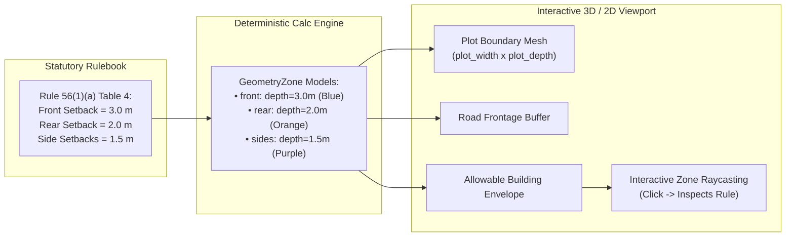
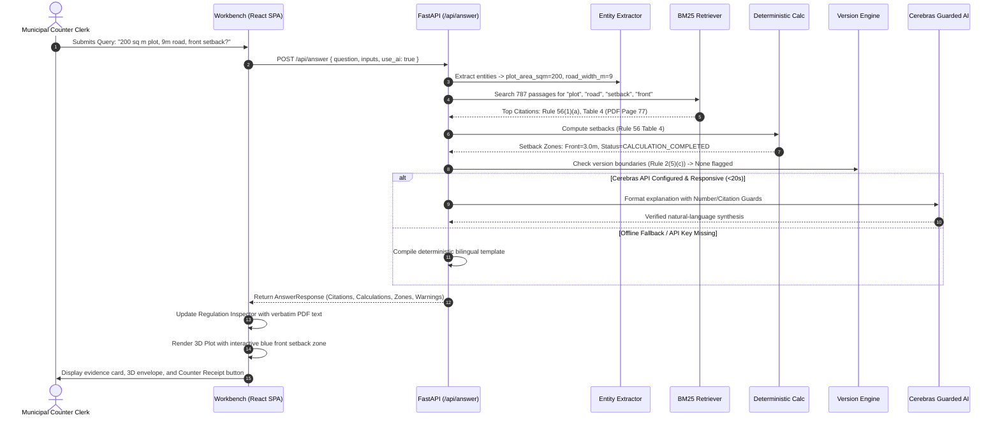

<div align="center">

# NIYAMLENS | नियमलेंस

### *See the Rule. Understand Its Impact.*  
#### *नियम देखें, प्रभाव समझें*

<p align="center">
  <strong>An AI-Assisted Regulatory Intelligence & 3D Spatial Decision-Support System</strong><br>
  <em>Engineered for the Building-Permission Counter at the Bhopal Municipal Corporation (BMC)</em>
</p>

---

<!-- Brand Tech Badges with Official Logos -->
<p align="center">
  <a href="https://www.python.org/"></a>
  <a href="https://fastapi.tiangolo.com/"></a>
  <a href="https://docs.pydantic.dev/"></a>
  <a href="https://cerebras.ai/"></a>
  <a href="https://react.dev/"></a>
  <a href="https://www.typescriptlang.org/"></a>
  <a href="https://threejs.org/"></a>
  <a href="https://tailwindcss.com/"></a>
  <a href="https://vite.dev/"></a>
  <a href="https://www.docker.com/"></a>
</p>

<!-- Verification & Metric Badges -->
<p align="center">
  <a href="docs/TESTING.md"></a>
  <a href="docs/TESTING.md"></a>
  <a href="docs/DATA_SOURCES.md"></a>
  <a href="docs/DECISIONS.md"></a>
  <a href="LICENSE"></a>
</p>

<p align="center">
  <a href="#executive-summary">Overview</a> •
  <a href="#system-architecture">Architecture</a> •
  <a href="#the-rule-to-geometry-engine">Rule-to-Geometry</a> •
  <a href="#benchmark-evaluation-17-questions">Benchmark</a> •
  <a href="#quick-start-in-5-steps">Quick Start</a> •
  <a href="#documentation-index">Documentation</a>
</p>

</div>

---

## Executive Summary

**NIYAMLENS** is a domain-specific regulatory intelligence platform built for municipal building-permission counters under **Claude Impact Lab 2026, Track 1: Bhumi Vikas Sahayak**.

When citizens arrive at the Bhopal Municipal Corporation counter asking building permission questions, clerks face a daunting task: manually navigating the 108-page, 105-rule *Madhya Pradesh Bhumi Vikas Rules, 2012*. Multi-bracket setback tables, fee schedules, and complex amendments make counter answers slow and error-prone. Misinterpreted setback rules frequently lead to rejected building plans, wasted citizen fees, and administrative friction.

### The Paradigm Shift: Beyond Generic RAG Chatbots

Standard generative chatbots ingest PDFs and hallucinate answers: they confuse table rows, invent building bye-laws, and perform erroneous arithmetic. 

**NIYAMLENS eliminates hallucination by enforcing complete architectural separation:**
1. **Law is Retrieved, Never Guessed:** Statutory provisions are indexed in-memory with exact physical PDF page attribution.
2. **Math is Executed in Code:** Setbacks, permission fees, and electrical safety clearances are evaluated deterministically in tested Python functions.
3. **Rules are Visualized in 3D:** The **Rule-to-Geometry Engine** translates abstract setback numbers into interactive, color-coded 3D spatial envelopes directly on the citizen's plot.
4. **Honest Uncertainty:** If inputs are missing, the system states `MORE_INFORMATION_NEEDED`. If outside the bye-laws (e.g., property tax), it states `NOT_FOUND`. If affected by recent legal changes, it flags `VERSION_REVIEW_NEEDED`.
5. **Zero-Failure Offline Resilience:** If the Cerebras AI inference key is absent or times out, NIYAMLENS seamlessly falls back to pre-verified bilingual deterministic templates.

```
┌────────────────────────────────────────────────────────────────────────────────────────┐
│                                 THE NIYAMLENS GUARANTEE                                │
├────────────────────────────────────────────────────────────────────────────────────────┤
│  ✓ Governing Provision:  Rule 56(1)(a), Table 4 (Official English PDF Page 77)         │
│  ✓ Statutory Condition:  Residential Use | Height <= 12.5m | Road Width 9m <= 12m     │
│  ✓ Deterministic Math:   Front Open Space = 3.0 m (Computed in Python, not LLM)        │
│  ✓ Rule-to-Geometry:     Interactive 3D plot renders blue front restriction zone       │
│  ✓ Traceable Evidence:   Clicking the 3D zone highlights Rule 56 excerpt in inspector  │
│  ✓ Counter Receipt:      Printable informational receipt with municipal disclaimer     │
└────────────────────────────────────────────────────────────────────────────────────────┘
```

---

## System Architecture

NIYAMLENS employs a decoupled, modular architecture designed for sub-millisecond retrieval, bulletproof legal traceability, and high rendering performance on municipal workstations.

```mermaid
graph TD
    subgraph Client ["Client Presentation Tier (React 19 + TypeScript + Vite)"]
        UI["Workbench Interface (pages/Workbench.tsx)"]
        AskBar["Bilingual Ask Bar (features/ask/AskBar.tsx)"]
        InputForm["Project Inputs Panel (features/inputs/ProjectInputsPanel.tsx)"]
        Viewport["Plot Viewport: 3D R3F + 2D SVG (features/plot3d/PlotViewport.tsx)"]
        Inspector["Regulation Inspector & Citations (features/inspector/RegulationInspector.tsx)"]
        Receipt["Counter Receipt Export (pages/ReceiptPage.tsx)"]
    end

    subgraph Backend ["Application Tier (FastAPI + Python 3.11)"]
        Router["FastAPI REST Router (/api)"]
        AnswerSvc["Answer Orchestration Service (services/answer.py)"]
        ExtractSvc["Bilingual Parameter Extractor (services/extraction.py)"]
        BM25Retriever["In-Memory BM25 Passage Search (services/retrieval.py)"]
        CalcEngine["Deterministic Calculation Engine (calculations/)"]
        TableValidator["Boot-Time Table Self-Verifier (rules/verified_tables.py)"]
        VersionEngine["Regulatory Version Warning Engine (rules/version_warnings.py)"]
        LLMGuard["Cerebras AI Client + Guardrails (services/llm.py)"]
    end

    subgraph Storage ["Statutory Corpus Substrate (In-Memory RAM)"]
        RuleStore[("In-Memory Rule Store: 106 Rules | 787 Passages | 108 Pages")]
        PDFRef[("Official English PDF (108 Pages) & Data Dictionary")]
    end

    subgraph External ["Inference Layer (Optional)"]
        Cerebras["Cerebras Cloud API (gpt-oss-120b)"]
    end

    AskBar -->|POST /api/answer| Router
    InputForm -->|POST /api/calculate| Router
    Router --> AnswerSvc

    AnswerSvc --> ExtractSvc
    AnswerSvc --> BM25Retriever
    AnswerSvc --> CalcEngine
    AnswerSvc --> VersionEngine
    AnswerSvc --> LLMGuard

    BM25Retriever <--> RuleStore
    TableValidator -.->|Boot-Time Cross-Check| RuleStore
    CalcEngine <--> TableValidator

    LLMGuard -.->|Inference (>20s fallback)| Cerebras
    LLMGuard -.->|Offline / Guard Trigger| AnswerSvc

    AnswerSvc -->|AnswerResponse (JSON)| Router
    Router --> UI

    UI --> Viewport
    UI --> Inspector
    UI --> Receipt
```

---

## Deep Architectural Breakdown

### 1. Statutory Memory & Running Header Passage Chunker (`app.rules.loader`)
* **Corpus Ingestion:** Loads `data/bhumi_vikas_rules.jsonl` (106 records) and `data/bhumi_vikas_rules_fulltext_by_page.txt` (108 pages) into memory on boot (< 20 MB RAM).
* **Page-Accurate Chunker:** Extracts exact physical PDF page breaks by parsing running PDF headers (`Rule[s]?\s+[0-9A-Za-z\-–, ]+?\s+M\.P\. Bhumi Vikas Rules, 2012\s+(\d+)`). Strips noise and indexes **787 granular passages** attributed to their authentic PDF page numbers (1 to 108).
* **Embedded Rule Extraction:** Rules inserted via subsequent gazettes (e.g., **Rule 12-A**, **Rule 17-a** *Agricultural Tourism*, **Rule 25(A)**, **Rule 26-A**, **Rule 42-A**, **Rule 93(a)**) physically reside inside their parent rule records. `find_embedded()` dynamically locates and routes them with accurate parent attribution.

### 2. Boot-Time Self-Verifying Table Engine (`app.rules.verified_tables`)
* **The Flattened Table Challenge:** Extracted PDF tables can suffer from alignment shifts or spacing anomalies.
* **The Zero-Drift Guard:** At server startup, `verify_against_store()` executes string cross-checks against the loaded document text for:
  - **Rule 56 Table 4:** Residential open spaces across road widths (up to 9m, 12m, 18m, 24m, 30m+).
  - **Rule 21 Tables:** Building permission fee schedules across residential, commercial, industrial, and institutional uses.
  - **Rule 52 Clearances:** Low/medium voltage, high voltage (≤33kV), and extra-high voltage safety distances.
  - **Rule 42 Tables:** High-rise open spaces.
* If any table check fails, the calculation is disabled with an administrative alert, preventing erroneous mathematical outputs.

### 3. Deterministic Calculation Engine (`app.calculations`)
Pure Python computation modules evaluate statutory requirements with zero LLM dependence:
* **`setbacks.py` (Rule 56 Table 4 & Rule 42):** Computes front open space based on street width; rear open space based on plot depth; side open spaces based on plot frontage and building type (detached, semi-detached, row).
* **`fees.py` (Rule 21):** Evaluates building permission fees based on proposed built-up area ($m^2$), height, and usage category.
* **`electric.py` (Rule 52):** Computes vertical and horizontal clearance buffers from overhead electrical lines.
* **Structured Missing Input Detection:** When a clerk asks a question lacking mandatory variables (e.g., asking for setback without specifying building height), the engine returns `MORE_INFORMATION_NEEDED` alongside explicit parameter prompts in English and Hindi.
* **Parametric Zone Generation:** Emits structured `GeometryZone` models (`front`, `rear`, `left`, `right`) with depth values ($m$) and compliance checks (`meets_minimum`, `below_minimum`) that feed directly into the 3D viewport.

### 4. Bilingual Parameter Extraction & BM25 Retrieval (`app.services`)
* **Entity Normalizer (`extraction.py`):** Normalizes colloquial units (square feet, square yards, feet, gaj) into standard statutory metric units (metres, $m^2$). Extracts road width, plot area, height, storeys, usage, and voltage classes using bilingual regex.
* **Hybrid BM25 Retriever (`retrieval.py`):** Indexes the 787 passages with an English-Hindi legal terminology expansion dictionary (*नक्शा* $\to$ plan, *अनुमति* $\to$ permission, *सड़क* $\to$ road, *ऊंचाई* $\to$ height).
* **Strict Relevance Guard:** Queries scoring below `MIN_SCORE = 9.0` (such as property tax or land registry rates) are rejected with `NOT_FOUND`, preventing the system from guessing irrelevant statutory clauses.

### 5. Guarded AI Inference & Zero-Downtime Fallback (`app.services.llm`)
* **Cerebras Cloud Inference:** Uses `cerebras_cloud_sdk` running `gpt-oss-120b` for rapid natural-language explanation synthesis.
* **Multi-Layer Defensive Guardrails:**
  1. **Citation Guard:** If the generated text mentions any Rule number not present in the retrieved citations, the response is discarded.
  2. **Number Guard:** If the generated explanation contains numerical values conflicting with the deterministic calculation engine, the response is rejected.
  3. **Strict Timeout Guard:** Requests exceeding 20 seconds are aborted.
* **Deterministic Template Fallback:** When `CEREBRAS_API_KEY` is omitted, or if the API times out or trips guardrails, the engine immediately serves verified bilingual templates, guaranteeing 100% counter uptime.

### 6. Regulatory Version Warning Engine (`app.rules.version_warnings`)
* **The August 28, 2026 Amendment:** Discloses that the consolidated rulebook ends at March 6, 2025. When queries touch **Rule 2(5)(c)** or development permissions for plots up to 500 $m^2$, the engine flags `VERSION_REVIEW_NEEDED` with warning `AMENDMENT_2026_RULE_2_5_C`.
* **Hindi Statutory Hierarchy:** Under Rule 4 (*Kurban Hussain v. Indore Municipal Corporation*), the gazetted Hindi text prevails over the English translation. Attaches `HINDI_TEXT_PREVAILS` to clarify that English text is the translation source.

---

## The Rule-to-Geometry Engine

The **Rule-to-Geometry Engine** is the visual centerpiece of NIYAMLENS. It bridges statutory text and physical architectural reality.



### Viewport Capabilities (`frontend/src/features/plot3d/`)
* **Interactive 3D Scene (`PlotScene3D.tsx`):** Powered by Three.js and `@react-three/fiber`. Renders plot ground plane, adjacent roadway, colored translucent restriction zones, dimension tick marks, and proposed building volumes.
* **2D Plan View (`PlotPlan2D.tsx`):** High-contrast architectural SVG projection for quick municipal counter inspection.
* **Zone-to-Evidence Raycasting:** Clicking on any 3D setback boundary fires a callback highlighting the exact statutory clause in the right-hand **Regulation Inspector**.
* **Perspective Controls:** One-click toggles between **Isometric (3D)**, **Top-Down (2D Plan)**, and **Front (Elevation)** cameras.
* **Performance & Accessibility:** Configured with `frameloop="demand"` and hardware-accelerated low-power shaders. Adheres to system `prefers-reduced-motion` settings.

---

## End-to-End Request Lifecycle



---

## Regulation Debugger Status Hierarchy

NIYAMLENS categorizes every inquiry into explicit, deterministic states:

| Status Badge | Significance | Visual Indicator |
| ------------ | ------------ | :--------------: |
| **`VERIFIED`** | Rule and inputs fully validated against verified statutory tables. | `Green Badge` |
| **`CALCULATION_COMPLETED`** | Numerical value (setback, fee, clearance) computed via deterministic Python code. | `Blue Badge` |
| **`SOURCE_FOUND`** | Statutory provisions located and displayed, but specific case math not yet evaluated. | `Teal Badge` |
| **`MORE_INFORMATION_NEEDED`** | Rule identified, but mandatory variables (e.g., height, use) are missing. | `Amber Badge` |
| **`VERSION_REVIEW_NEEDED`** | Rule affected by legal amendments published after March 6, 2025. | `Purple Badge` |
| **`NOT_FOUND`** | Query topic falls outside the *M.P. Bhumi Vikas Rules, 2012*. | `Slate Badge` |
| **`ILLUSTRATIVE_ONLY`** | Geometry is explanatory and does not imply official plan sanction. | `Zinc Badge` |

---

## Benchmark Evaluation: 17 Questions

All 17 sample questions from `resources/sample_questions.md` were evaluated using `backend/scripts/eval_samples.py`. Results are logged in [docs/evaluation_results.json](file:///c:/Users/vastu/OneDrive/Desktop/Projects/ImpactLab/docs/evaluation_results.json).

```bash
cd backend
python scripts/eval_samples.py
```

| # | Question Summary | Language | Primary Status | Governing Rule Cited | Calculations Executed | Missing Inputs Detected | Warnings Flagged |
| - | ---------------- | :------: | :------------: | :------------------: | :-------------------: | :---------------------: | :--------------: |
| **1** | House faces 10m street, 9m tall. Front setback? | EN | `CALCULATION_COMPLETED` | Rule 56 (p. 77) | Front open space: **3.6 m** [VERIFIED] | None | None |
| **2** | Farm house on agricultural land. Plot size & FAR? | EN | `SOURCE_FOUND` | Rule 17 (p. 34), Rule 53 (p. 71) | — | None | None |
| **3** | Development permission granted in 2023. Validity & renewals? | EN | `SOURCE_FOUND` | Rule 23 (p. 41), Rule 12 (p. 20) | — | None | None |
| **4** | Authority missed deadline for building permission. Consequence? | EN | `SOURCE_FOUND` | Rule 28 (p. 48) | — | None | None |
| **5** | Low-voltage electric line clearance (vert / horiz)? | EN | `CALCULATION_COMPLETED` | Rule 52 (p. 69) | Vert: **2.5 m**, Horiz: **1.2 m** [VERIFIED] | None | None |
| **6** | Who is allowed to sign and submit building plans? | EN | `SOURCE_FOUND` | Rule 18 (p. 34), Rule 26 (p. 45) | — | None | None |
| **7** | Documents required with building permission application? | EN | `SOURCE_FOUND` | Rule 16 (p. 32), Rule 14 (p. 22) | — | None | None |
| **8** | Fee for building permission for residential house? | EN | `MORE_INFORMATION_NEEDED` | Rule 21 (p. 36) | Permission fee: — [MORE_INFORMATION_NEEDED] | `built_up_area_sqm`, `building_height_m` | None |
| **9** | Can a plan be changed after sanction? | EN | `SOURCE_FOUND` | Rule 24 (p. 41) | — | None | None |
| **10** | Minimum rear open space for 150 sq m residential plot? | EN | `MORE_INFORMATION_NEEDED` | Rule 56 (p. 78) | Rear open space: — [MORE_INFORMATION_NEEDED] | `building_height_m` | None |
| **11** | Separate dev permission for 300 sq m plot? (Changed Aug 2026) | EN | `VERSION_REVIEW_NEEDED` | Rule 2 (p. 4), Rule 12 (p. 20) | — | None | **`AMENDMENT_2026_RULE_2_5_C`** |
| **12** | Conflict between Development Plan and Rules? | EN | `SOURCE_FOUND` | Rule 103 (p. 107) | — | None | None |
| **13** | Rules for lifts in buildings taller than 15m? | EN | `SOURCE_FOUND` | Rule 83 (p. 95) | — | None | None |
| **14** | 200 वर्ग मीटर प्लॉट, 9 मीटर सड़क। आगे की जगह? | HI | `MORE_INFORMATION_NEEDED` | Rule 56 (p. 77) | Front open space: — [MORE_INFORMATION_NEEDED] | `building_height_m`, `building_use` | **`HINDI_TEXT_PREVAILS`** |
| **15** | बिल्डिंग परमिशन की फीस कितनी है? | HI | `MORE_INFORMATION_NEEDED` | Rule 21 (p. 36) | Permission fee: — [MORE_INFORMATION_NEEDED] | `built_up_area_sqm`, `building_use`, `building_height_m` | **`HINDI_TEXT_PREVAILS`** |
| **16** | How do I pay my property tax online? | EN | `NOT_FOUND` | *None* | — | None | None |
| **17** | Current market rate for land in Kolar Road? | EN | `NOT_FOUND` | *None* | — | None | None |

---

## Technology Stack

```
                              NIYAMLENS TECH STACK
┌──────────────────────────────────────────────────────────────────────────────────┐
│  FRONTEND (SPA)           BACKEND API (REST)            DATA & INGESTION         │
│  ─────────────────        ───────────────────           ────────────────         │
│  • React 19.x             • Python 3.11+                • 106 JSONL Records      │
│  • TypeScript 5.x         • FastAPI 0.118               • 108 Page Text Index    │
│  • Vite 8.x               • Pydantic v2.x               • In-Memory BM25 Index   │
│  • Tailwind CSS v4        • Uvicorn (ASGI)              • Verified Table Guards  │
│  • Three.js / R3F         • HTTPX (Client)              • Embedded Rule Parsers  │
│  • Radix UI / Lucide      • Cerebras SDK (gpt-oss-120b) • Pytest (116 Tests)     │
└──────────────────────────────────────────────────────────────────────────────────┘
```

---

## Quick Start in 5 Steps

### Step 1: Clone the Repository
```bash
git clone https://github.com/ut3av/ImpactLab.git
cd ImpactLab
```

### Step 2: Set Up Python Backend Virtual Environment
```bash
python -m venv .venv
# Windows (PowerShell):
.venv\Scripts\Activate.ps1
# Linux / macOS:
source .venv/bin/activate

cd backend
pip install -r requirements.txt
pip install -r requirements-dev.txt
```

### Step 3: Run the Test Suite (116 Tests)
```bash
pytest -q
# Expected: 116 passed in ~1.8s
```

### Step 4: Configure Environment (Optional)
```bash
cp ../.env.example ../.env
# Edit ../.env to add CEREBRAS_API_KEY.
# If omitted, NIYAMLENS runs offline with 100% verified template answers!
```

### Step 5: Launch the Application
```bash
# Start backend server
uvicorn app.main:app --reload --port 8000
```
* **API Health:** [http://localhost:8000/api/health](http://localhost:8000/api/health)
* **Interactive Docs:** [http://localhost:8000/api/docs](http://localhost:8000/api/docs)

*(To launch the React development frontend, open a separate terminal, navigate to `frontend/`, run `npm install`, and run `npm run dev` to access the UI at `http://localhost:5173`.)*

---

## Production Deployment & Docker

NIYAMLENS is containerized as a **Single-Origin Monolithic Container**:
1. **Frontend Compilation:** Stage 1 uses `node:20-slim` to compile the React SPA into static assets (`frontend/dist`).
2. **Runtime Serving:** Stage 2 uses `python:3.11-slim` where FastAPI serves the JSON API under `/api/*` and static SPA files under `/`.

```bash
# Build production Docker image
docker build -t niyamlens:latest .

# Run container locally
docker run -p 8000:8000 -e PORT=8000 niyamlens:latest
```

Detailed deployment configurations for **Render**, **Railway**, and custom Linux servers are documented in [docs/DEPLOYMENT.md](file:///c:/Users/vastu/OneDrive/Desktop/Projects/ImpactLab/docs/DEPLOYMENT.md).

---

## Regulatory Disclaimers & Provenance

1. **Informational Prototype, Not Official Sanction:** NIYAMLENS is a decision-support prototype. It does not issue official building permissions or replace the statutory authority of municipal officers under the *M.P. Nagar Tatha Gram Nivesh Adhiniyam, 1973*.
2. **Consolidation Cutoff Date (March 6, 2025):** The official statutory text bundled with this repository represents the rules consolidated up to March 6, 2025. Subsequent amendments (such as the August 28, 2026 amendment to Rule 2(5)(c)) are flagged for manual verification.
3. **Hindi Statutory Primacy:** Under judicial precedent (*Kurban Hussain v. Indore Municipal Corporation*, PDF page 15), the official Hindi gazette text prevails. Because the Hindi PDF uses non-Unicode legacy fonts, NIYAMLENS parses the official English translation and supplies Hindi explanations.

---

## Documentation Index

| Guide | Description |
| ----- | ----------- |
| [Product Requirements Document (prd.md)](prd.md) | Functional requirements, acceptance criteria, non-goals, and MVP scope. |
| [Architecture Specification (docs/ARCHITECTURE.md)](docs/ARCHITECTURE.md) | Deep architectural blueprint, request flows, and subsystem breakdown. |
| [Data Sources Guide (docs/DATA_SOURCES.md)](docs/DATA_SOURCES.md) | Complete inventory of the 106 rules, PDF nuances, and amendment notices. |
| [Development Guide (docs/DEVELOPMENT.md)](docs/DEVELOPMENT.md) | Local environment setup, package manifests, and developer troubleshooting. |
| [Testing & Evaluation (docs/TESTING.md)](docs/TESTING.md) | 116 Pytest test suite breakdown and the 17 sample questions benchmark. |
| [Deployment Guide (docs/DEPLOYMENT.md)](docs/DEPLOYMENT.md) | Multi-stage Docker packaging and cloud platform setup (Render). |
| [Architecture Decisions (docs/DECISIONS.md)](docs/DECISIONS.md) | Formal records of core technical decisions (ADRs 001–010). |
| [Contributing Guidelines (CONTRIBUTING.md)](CONTRIBUTING.md) | Rule addition protocols, self-verifying test requirements, and PR process. |
| [Security Policy (SECURITY.md)](SECURITY.md) | Responsible vulnerability disclosure, secret safety, and defensive boundaries. |
| [Support Guide (SUPPORT.md)](SUPPORT.md) | Official support channels and communication guidelines. |
| [Changelog (CHANGELOG.md)](CHANGELOG.md) | Record of notable changes and completed components. |

---

## Acknowledgements & Attribution

* **Event:** Claude Impact Lab × Cerebras Café Compute, Bhopal (11 October 2026).
* **Track:** Track 1: Bhumi Vikas Sahayak.
* **Organisers:** Aniket Sahu (Claude Community Ambassador) and Arun Pratap Singh Chandel (Cerebras Community Ambassador).
* **Statutory Body:** Directorate of Town and Country Planning, Government of Madhya Pradesh.
* **Source Repository:** [Bhopal Impact Lab 2026 Problem Statements](https://github.com/Vishal4742/bhopal-impact-lab-2026-problem-statements).
* **Application Repository:** [https://github.com/ut3av/ImpactLab](https://github.com/ut3av/ImpactLab).
* **Licence:** MIT License for application code (see [LICENSE](LICENSE)). Official statutory PDFs and datasets remain public government works.
