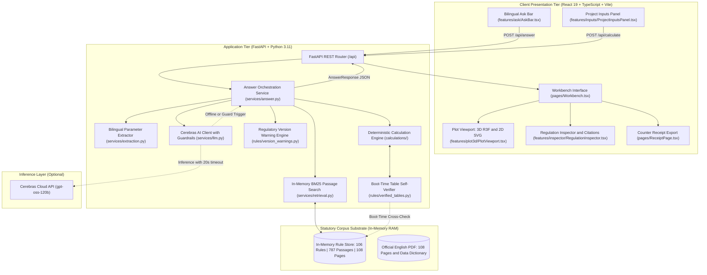
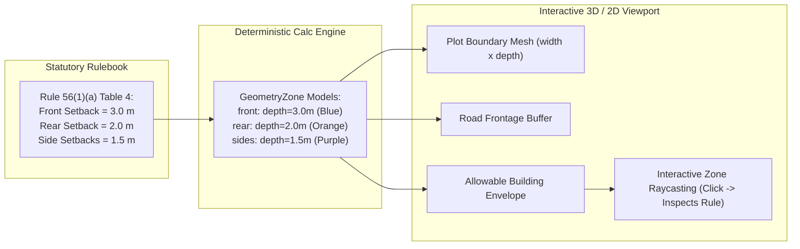

<div align="center">

# NIYAMLENS · नियमलेंस

### *Visual Building Regulation Intelligence · See the Rule. Understand Its Impact.*
#### *नियम देखें, प्रभाव समझें*

<p align="center">
  <strong>An Evidence-Backed Regulatory Intelligence & 3D Spatial Decision-Support System</strong><br>
  <em>Engineered for the Building-Permission Counter at the Bhopal Municipal Corporation (BMC)</em>
</p>

---

<!-- Official Brand Badges with Official Logos -->
<p align="center">
  <a href="https://www.python.org/"></a>
  <a href="https://fastapi.tiangolo.com/"></a>
  <a href="https://docs.pydantic.dev/"></a>
  <a href="https://cerebras.ai/"></a>
  <a href="https://react.dev/"></a>
  <a href="https://www.typescriptlang.org/"></a>
  <a href="https://threejs.org/"></a>
  <a href="https://tailwindcss.com/"></a>
  <a href="https://vite.dev/"></a>
  <a href="https://www.docker.com/"></a>
</p>

<!-- Verification & Metric Badges -->
<p align="center">
  <a href="docs/TESTING.md"></a>
  <a href="docs/TESTING.md"></a>
  <a href="docs/DATA_SOURCES.md"></a>
  <a href="docs/DECISIONS.md"></a>
  <a href="LICENSE"></a>
</p>

<p align="center">
  <a href="#geospatial-focus--bhopal-municipal-corporation">Geospatial Focus</a> •
  <a href="#the-problem-at-the-counter">The Problem</a> •
  <a href="#the-niyamlens-solution">Solution</a> •
  <a href="#system-architecture">Architecture</a> •
  <a href="#the-rule-to-geometry-engine">Rule-to-Geometry</a> •
  <a href="#benchmark-evaluation-17-questions">17 Benchmarks</a> •
  <a href="#quick-start-in-5-steps">Quick Start</a> •
  <a href="#documentation-index">Docs Index</a>
</p>

</div>

---

| Team | Members | Track | Target User | Location Context |
|---|---|---|---|---|
| **NIYAMLENS Team** | Open Source Contributors | Claude Impact Lab 2026 · Track 1: Bhumi Vikas Sahayak | BMC Building-Permission Counter Clerk | SSR Global Skills Park, Bhopal, MP |

> **Administrative & Legal Notice:** Informational decision-support prototype only. Not an official building permit, plan sanction, or binding legal opinion under the *M.P. Nagar Tatha Gram Nivesh Adhiniyam, 1973* or the *M.P. Bhumi Vikas Rules, 2012*. Final administrative discretion remains exclusively with the competent municipal authority. Not officially endorsed by the Government of Madhya Pradesh, MPSeDC, or the Bhopal Municipal Corporation.

---

## Geospatial Focus · Bhopal Municipal Corporation

<div align="center">

```
                           THE JURISDICTIONAL CONTEXT
      ──────────────────────────────────────────────────────────────────
      • Primary Coordinates : 23.2599° N, 77.4126° E (Bhopal, MP, India)
      • Municipal Counter   : Building Permission Cell, Bhopal Municipal Corporation
      • Statutory Enactment : Madhya Pradesh Bhumi Vikas Rules, 2012
      • Consolidation Date  : 6 March 2025 (Directorate of Town & Country Planning)
      • Amendment Boundary  : 28 August 2026 (Rule 2(5)(c) plots up to 500 sq m)
      ──────────────────────────────────────────────────────────────────
```

</div>

NIYAMLENS is rooted in the physical and legal topography of **Bhopal, Madhya Pradesh**. Every building permit issued in Bhopal—from residential plots in Kolar Road and Arera Colony to commercial setups in MP Nagar—is governed by the *Madhya Pradesh Bhumi Vikas Rules, 2012*. 

The system treats statutory geography not as generic text, but as exact physical coordinates, street width thresholds, and volumetric plot boundaries.

---

## The Problem at the Counter

When a citizen visits the building-permission counter at the Bhopal Municipal Corporation, they ask straightforward questions:
> *"My plot is 200 sq m on a 9 m road. How much front setback do I need to leave, how many floors can I build, and what fee do I pay?"*

In practice, answering this within a minute is difficult:
1. **Scattered Multi-Bracket Tables:** Key requirements (setbacks, height limits, fees) sit in multi-column tables spread across 108 pages and 105 numbered rules.
2. **Flattened Text & Misreading Risks:** Table columns in digital text have flattened spacing; interpreting which row governs a specific plot width or height bracket is error-prone.
3. **Outdated Consolidated Source:** The state's consolidated PDF stops at **6 March 2025**. On **28 August 2026**, Rule 2(5)(c) regarding development permissions for plots up to 500 sq m changed again. An outdated rulebook misleads the clerk.
4. **The Legacy Hindi Font Challenge:** Citizens ask questions in Hindi, but the official Hindi PDF uses a non-Unicode legacy font (Kruti Dev/Chanakya) that copies out as unreadable characters. Yet legally, under Rule 4 (*Kurban Hussain v. Indore Municipal Corporation*), the Hindi text prevails over English translations.
5. **High Financial Cost of Errors:** Citizens often pay architect fees, prepare drawings, and submit payments—only to learn weeks later that their plan violates an obscure setback table.

---

## The NIYAMLENS Solution

NIYAMLENS provides a complete, grounded workflow that replaces speculative chat with verified legal evidence and 3D spatial geometry:

```
┌────────────────────────────────────────────────────────────────────────────────────────┐
│                              THE NIYAMLENS GUARANTEE                                   │
├────────────────────────────────────────────────────────────────────────────────────────┤
│  ✓ Page-Accurate Citations:  Rule 56(1)(a), Table 4 (Official English PDF Page 77)     │
│  ✓ Deterministic Math:       Python evaluates exact numbers; zero LLM arithmetic       │
│  ✓ 3D Rule-to-Geometry:      Interactive plot renders color-coded setback envelopes    │
│  ✓ Transparent Provenance:   Clicking any 3D zone highlights the verbatim rule clause   │
│  ✓ Honest Uncertainty:       Flags missing inputs; returns NOT FOUND for out-of-scope  │
│  ✓ Version Review Warning:   Detects queries affected by the August 28, 2026 amendment │
│  ✓ Offline AI Fallback:      100% counter uptime with deterministic template summaries │
│  ✓ Citizen Counter Receipt:  Printable summary with citations and legal disclaimers    │
└────────────────────────────────────────────────────────────────────────────────────────┘
```

| Dimension | Generic RAG Chatbot | NIYAMLENS |
|---|---|---|
| **Math & Numbers** | LLM guesses arithmetic; frequently miscalculates table rows. | **Deterministic Code:** Pure Python functions evaluate exact table brackets. |
| **Spatial Understanding** | Text descriptions only (*"leave 3m front space"*). | **Rule-to-Geometry Engine:** Interactive 3D plot rendering verified zones. |
| **Out-of-Scope Topics** | Hallucinates plausible answers for property tax or land rates. | **Regulation Debugger:** Strictly rejects out-of-scope queries with `NOT_FOUND`. |
| **Statutory Amendments** | Blindly answers from outdated consolidated PDFs. | **Version Engine:** Flags provisions amended after March 2025 (`VERSION_REVIEW_NEEDED`). |
| **AI Availability** | Hard dependency; breaks if API key is absent or rate-limited. | **Offline Fallback:** Operates with verified templates when Cerebras is unconfigured. |
| **Citizen Handover** | Unformatted chat text. | **Counter Receipt:** Clean, printable informational receipt for citizen handover. |

---

## System Architecture

NIYAMLENS employs a three-tier decoupled architecture: in-memory statutory memory, deterministic Python calculation services, and a guarded presentation layer with on-demand 3D spatial rendering.



---

## Deep Architectural Breakdown

### 1. In-Memory Corpus Substrate & Chunker (`app.rules.loader`)
* **Corpus Ingestion:** Loads `data/bhumi_vikas_rules.jsonl` (106 records) and `data/bhumi_vikas_rules_fulltext_by_page.txt` (108 pages) into memory at startup (< 20 MB RAM footprint).
* **Page-Accurate Passage Splitting:** Parses PDF running headers (`Rule[s]?\s+[0-9A-Za-z\-–, ]+?\s+M\.P\. Bhumi Vikas Rules, 2012\s+(\d+)`) to detect exact page breaks, splitting the text into **787 passages** mapped to their true PDF page numbers (1 to 108).
* **Embedded Rule Detection:** Rules inserted by subsequent amendments (e.g., **Rule 12-A**, **Rule 17-a**, **Rule 25(A)**, **Rule 26-A**, **Rule 42-A**, **Rule 93(a)**) physically reside inside parent rule records. `find_embedded()` dynamically detects and routes them with accurate parent attribution.

### 2. Startup Table Self-Verification (`app.rules.verified_tables`)
* To guard against flattened table alignment errors, `verify_against_store()` executes verbatim string cross-checks against loaded PDF text at startup for:
  - **Rule 56 Table 4:** Residential setbacks across road widths (up to 9m, 12m, 18m, 24m, 30m+).
  - **Rule 21 Tables:** Permission fees across residential, commercial, industrial, and social slabs.
  - **Rule 52 Tables:** Overhead electrical clearance buffers.
  - **Rule 42 Tables:** High-rise building open spaces.
* If any self-check fails, the calculation is disabled with an administrative alert (`/api/health` reports `13/13` verified).

### 3. Deterministic Calculation Engine (`app.calculations`)
Pure Python functions evaluate statutory rules with zero LLM arithmetic:
* **`setbacks.py`:** Evaluates front, rear, and side open spaces under Rule 56 Table 4 and Rule 42 based on road width, plot size, height, and usage.
* **`fees.py`:** Calculates building permission fees under Rule 21 across residential, commercial, industrial, and institutional slabs.
* **`electric.py`:** Computes horizontal and vertical safety clearances under Rule 52 for low/medium, high (≤33kV), and extra-high voltage lines.
* **Structured Missing Input Detection:** When mandatory parameters (e.g. building height) are omitted, the engine returns `MORE_INFORMATION_NEEDED` alongside explicit field guidance.
* **Parametric Zone Models:** Emits structured `GeometryZone` models (`front`, `rear`, `left`, `right`) with depth values ($m$) and compliance checks (`meets_minimum`, `below_minimum`) that feed directly into the 3D viewport.

### 4. Bilingual Parameter Extraction & BM25 Search (`app.services`)
* **Entity Extraction (`extraction.py`):** Normalizes colloquial units (sq ft, sq yards, feet, gaj) into standard metric units (metres, $m^2$). Extracts road width, plot area, height, storeys, usage, and voltage classes.
* **BM25 Search (`retrieval.py`):** Indexes 787 passages with an English-Hindi legal terminology glossary (*नक्शा* $\to$ plan, *अनुमति* $\to$ permission, *सड़क* $\to$ road, *ऊंचाई* $\to$ height).
* **Strict Relevance Guard:** Queries scoring below `MIN_SCORE = 9.0` (such as property tax or land market rates) are rejected with `NOT_FOUND`.

### 5. Guarded AI Inference & Zero-Downtime Fallback (`app.services.llm`)
* **Cerebras Cloud SDK:** Uses `cerebras_cloud_sdk` running `gpt-oss-120b` for rapid natural-language explanation formatting.
* **Defensive Guardrails:**
  1. *Citation Guard:* Discards explanations that mention any Rule not present in the retrieved citations.
  2. *Number Guard:* Discards explanations containing numbers conflicting with the deterministic calculation engine.
  3. *Timeout Guard:* Aborts requests exceeding 20 seconds.
* **Deterministic Template Fallback:** When `CEREBRAS_API_KEY` is omitted, or if the API times out or trips guardrails, the engine immediately serves verified bilingual templates, guaranteeing 100% counter uptime.

### 6. Regulatory Version Warning Engine (`app.rules.version_warnings`)
* **August 28, 2026 Amendment:** Detects queries touching Rule 2(5)(c) or development permissions for plots up to 500 $m^2$ and attaches warning `AMENDMENT_2026_RULE_2_5_C` with status `VERSION_REVIEW_NEEDED`.
* **Hindi Statutory Hierarchy:** Discloses under Rule 4 that English quotations are authoritative translations and that Hindi summaries are generated explanations (`HINDI_TEXT_PREVAILS`).

---

## The Rule-to-Geometry Engine

The **Rule-to-Geometry Engine** is the visual differentiator of NIYAMLENS, translating abstract statutory clauses into interactive 3D spatial envelopes.



* **Interactive 3D Viewport (`PlotScene3D.tsx`):** Built with Three.js and `@react-three/fiber`. Renders ground plot boundary, adjacent street, colored restriction zones, dimension tick marks, and proposed building volumes.
* **2D Plan View (`PlotPlan2D.tsx`):** High-contrast architectural SVG projection for fast counter inspection.
* **Zone-to-Evidence Raycasting:** Clicking any 3D setback boundary highlights the governing statutory clause in the right-hand **Regulation Inspector**.
* **Perspective Controls:** One-click toggles between **Isometric (3D)**, **Top-Down (2D Plan)**, and **Front (Elevation)** cameras.
* **Performance & Accessibility:** Uses `frameloop="demand"` and hardware-accelerated shaders. Supports `prefers-reduced-motion`.

---

## End-to-End Request Lifecycle


---

## Verified Rules and Calculations

The following calculations are verified and implemented in code. Each was checked by hand against the **text layer of the official English PDF** on the stated page:

| Calculation | Governing Rule & Page | Inputs Required | Output & Enforcement |
|---|---|---|---|
| **Front Open Space** (Residential ≤ 12.5m) | Rule 56(1)(a) Table 4 (p. 77) | Street width, height, use | Front setback depth ($m$) + narrow street proviso 56(1)(b) |
| **Rear Open Space** (Residential ≤ 12.5m) | Rule 56(2)(a) Table (p. 78) | Plot area or depth, height, use | Rear setback depth ($m$) |
| **Side Open Spaces** (Residential ≤ 12.5m) | Rule 56(3) (p. 78) | Building type (detached, semi, row), height, frontage | Left and right side setback depths ($m$) |
| **High-Rise Open Spaces** (Height > 12.5m) | Rule 56(5) $\to$ Rule 42 Tables 4 & 5 (p. 58–59) | Height, storeys, road width | Mandatory perimeter setbacks ($m$) per height bracket |
| **Building Permission Fees** | Rule 21(3)(b) items 1–6 (p. 36), 21(3)(c) (p. 37) | Built-up area ($m^2$), use, height | Total statutory fee ($₹$) with application fee breakdown |
| **Overhead Electric Line Clearances** | Rule 52(1) (p. 69) | Voltage class (low/med, high ≤33kV, extra-high) | Minimum vertical and horizontal clearances ($m$) |

*Deliberately not calculated:* FAR (outside Rule 42 rows), parking space schedules, and ground coverage. For those topics, NIYAMLENS provides verbatim cited passages (`SOURCE_FOUND`), never fabricated numbers.

---

## Benchmark Evaluation: 17 Questions

All 17 sample questions from `resources/sample_questions.md` were evaluated using `backend/scripts/eval_samples.py`. Results are logged in [docs/evaluation_results.json](docs/evaluation_results.json).

```bash
cd backend
python scripts/eval_samples.py
```

| # | Question Summary | Language | Primary Status | Governing Rule Cited | Calculations Executed | Missing Inputs Detected | Warnings Flagged |
| - | ---------------- | :------: | :------------: | :------------------: | :-------------------: | :---------------------: | :--------------: |
| **1** | House faces 10m street, 9m tall. Front setback? | EN | `CALCULATION_COMPLETED` | Rule 56 (p. 77) | Front open space: **3.6 m** [VERIFIED] | None | None |
| **2** | Farm house on agricultural land. Plot size & FAR? | EN | `SOURCE_FOUND` | Rule 17 (p. 34), Rule 53 (p. 71) | — | None | None |
| **3** | Development permission granted in 2023. Validity & renewals? | EN | `SOURCE_FOUND` | Rule 23 (p. 41), Rule 12 (p. 20) | — | None | None |
| **4** | Authority missed deadline for building permission. Consequence? | EN | `SOURCE_FOUND` | Rule 28 (p. 48) | — | None | None |
| **5** | Low-voltage electric line clearance (vert / horiz)? | EN | `CALCULATION_COMPLETED` | Rule 52 (p. 69) | Vert: **2.5 m**, Horiz: **1.2 m** [VERIFIED] | None | None |
| **6** | Who is allowed to sign and submit building plans? | EN | `SOURCE_FOUND` | Rule 18 (p. 34), Rule 26 (p. 45) | — | None | None |
| **7** | Documents required with building permission application? | EN | `SOURCE_FOUND` | Rule 16 (p. 32), Rule 14 (p. 22) | — | None | None |
| **8** | Fee for building permission for residential house? | EN | `MORE_INFORMATION_NEEDED` | Rule 21 (p. 36) | Permission fee: — [MORE_INFORMATION_NEEDED] | `built_up_area_sqm`, `building_height_m` | None |
| **9** | Can a plan be changed after sanction? | EN | `SOURCE_FOUND` | Rule 24 (p. 41) | — | None | None |
| **10** | Minimum rear open space for 150 sq m residential plot? | EN | `MORE_INFORMATION_NEEDED` | Rule 56 (p. 78) | Rear open space: — [MORE_INFORMATION_NEEDED] | `building_height_m` | None |
| **11** | Separate dev permission for 300 sq m plot? (Changed Aug 2026) | EN | `VERSION_REVIEW_NEEDED` | Rule 2 (p. 4), Rule 12 (p. 20) | — | None | **`AMENDMENT_2026_RULE_2_5_C`** |
| **12** | Conflict between Development Plan and Rules? | EN | `SOURCE_FOUND` | Rule 103 (p. 107) | — | None | None |
| **13** | Rules for lifts in buildings taller than 15m? | EN | `SOURCE_FOUND` | Rule 83 (p. 95) | — | None | None |
| **14** | 200 वर्ग मीटर प्लॉट, 9 मीटर सड़क। आगे की जगह? | HI | `MORE_INFORMATION_NEEDED` | Rule 56 (p. 77) | Front open space: — [MORE_INFORMATION_NEEDED] | `building_height_m`, `building_use` | **`HINDI_TEXT_PREVAILS`** |
| **15** | बिल्डिंग परमिशन की फीस कितनी है? | HI | `MORE_INFORMATION_NEEDED` | Rule 21 (p. 36) | Permission fee: — [MORE_INFORMATION_NEEDED] | `built_up_area_sqm`, `building_use`, `building_height_m` | **`HINDI_TEXT_PREVAILS`** |
| **16** | How do I pay my property tax online? | EN | `NOT_FOUND` | *None* | — | None | None |
| **17** | Current market rate for land in Kolar Road? | EN | `NOT_FOUND` | *None* | — | None | None |

---

## Quick Start in 5 Steps

### Step 1: Clone the Repository
```bash
git clone https://github.com/ut3av/ImpactLab.git
cd ImpactLab
```

### Step 2: Set Up Python Backend Virtual Environment
```bash
python -m venv .venv
# Windows (PowerShell):
.venv\Scripts\Activate.ps1
# Linux / macOS:
source .venv/bin/activate

cd backend
pip install -r requirements.txt
pip install -r requirements-dev.txt
```

### Step 3: Run Backend Tests (116 Tests)
```bash
pytest -q
# Expected: 116 passed in ~1.8s
```

### Step 4: Configure Environment (Optional)
```bash
cp ../.env.example ../.env
# Edit ../.env to configure CEREBRAS_API_KEY.
# If omitted, NIYAMLENS runs offline with 100% verified template answers!
```

### Step 5: Launch the Application
```bash
# Start backend server
uvicorn app.main:app --reload --port 8000
```
Visit:
* API Health: [http://localhost:8000/api/health](http://localhost:8000/api/health)
* Interactive Swagger Docs: [http://localhost:8000/api/docs](http://localhost:8000/api/docs)

*(To launch the React frontend in dev mode: open a separate terminal, run `cd frontend`, `npm install`, and `npm run dev` to view the UI at `http://localhost:5173`.)*

---

## Production Deployment & Docker

NIYAMLENS is packaged as a **Single-Origin Monolithic Container**:
1. **Frontend Compilation:** Stage 1 uses `node:22-slim` to compile the React 19 SPA into static assets (`frontend/dist`).
2. **Runtime Serving:** Stage 2 uses `python:3.13-slim` where FastAPI serves the JSON API under `/api/*` and static SPA files under `/`. A non-root user (`appuser`, UID 10001) runs the process.
3. **Statutory Data:** Packaged directly inside `data/` in the image — no database or external API dependencies at startup.

```bash
# Build production Docker image
docker build -t niyamlens:latest .

# Run container locally (binds 0.0.0.0:8000)
docker run -p 8000:8000 -e PORT=8000 niyamlens:latest
```

The repository includes a ready-to-deploy **Render Blueprint** (`render.yaml`) targeting the Singapore region with health check `/api/health`. See [docs/DEPLOYMENT.md](docs/DEPLOYMENT.md) for full deployment instructions, environment variables, and CI/CD details.


---

## Documentation Index

| Document | Purpose |
|---|---|
| [Product Requirements Document (prd.md)](prd.md) | Full specifications, acceptance criteria, non-goals, and MVP scope. |
| [Architecture Specification (docs/ARCHITECTURE.md)](docs/ARCHITECTURE.md) | Detailed system architecture, pipelines, and subsystem designs. |
| [Data Sources & Provenance (docs/DATA_SOURCES.md)](docs/DATA_SOURCES.md) | Statutory data inventory, font nuances, and amendment notices. |
| [Development Guide (docs/DEVELOPMENT.md)](docs/DEVELOPMENT.md) | Local environment setup, dependencies, scripts, and troubleshooting. |
| [Testing & Benchmarks (docs/TESTING.md)](docs/TESTING.md) | 116 Pytest test suite breakdown and the 17 sample questions evaluation. |
| [Deployment Guide (docs/DEPLOYMENT.md)](docs/DEPLOYMENT.md) | Multi-stage Docker packaging and Render cloud hosting. |
| [Architecture Decisions (docs/DECISIONS.md)](docs/DECISIONS.md) | Formal records of core technical decisions (ADRs 001–010). |
| [Contributing Guidelines (CONTRIBUTING.md)](CONTRIBUTING.md) | Contribution protocols, self-verifying test requirements, and PR process. |
| [Security Policy (SECURITY.md)](SECURITY.md) | Responsible vulnerability disclosure, secret safety, and defensive boundaries. |
| [Support Guide (SUPPORT.md)](SUPPORT.md) | Support channels and communication guidelines. |
| [Changelog (CHANGELOG.md)](CHANGELOG.md) | Record of notable changes and completed components. |

---

## Acknowledgements & Attribution

* **Event:** Claude Impact Lab × Cerebras Café Compute, Bhopal (11 October 2026).
* **Track:** Track 1: Bhumi Vikas Sahayak.
* **Organisers:** Aniket Sahu (Claude Community Ambassador) and Arun Pratap Singh Chandel (Cerebras Community Ambassador).
* **Statutory Authority:** Directorate of Town and Country Planning, Government of Madhya Pradesh.
* **Source Problem Repository:** [Bhopal Impact Lab 2026 Problem Statements](https://github.com/Vishal4742/bhopal-impact-lab-2026-problem-statements).
* **Application Repository:** [https://github.com/ut3av/ImpactLab](https://github.com/ut3av/ImpactLab).
* **Licence:** MIT License for application code (see [LICENSE](LICENSE)). Statutory PDFs and government datasets remain public regulatory works.
