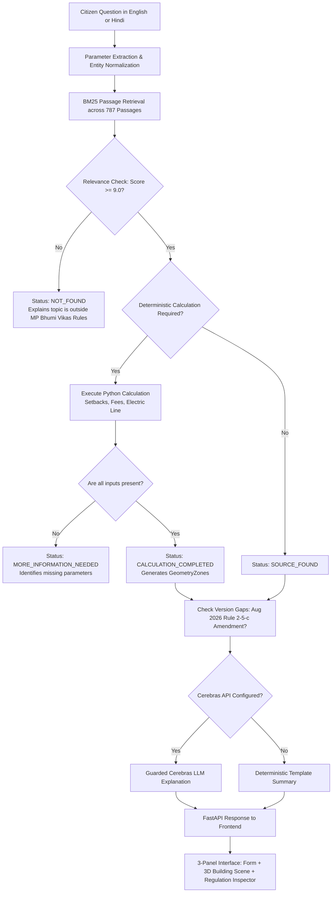
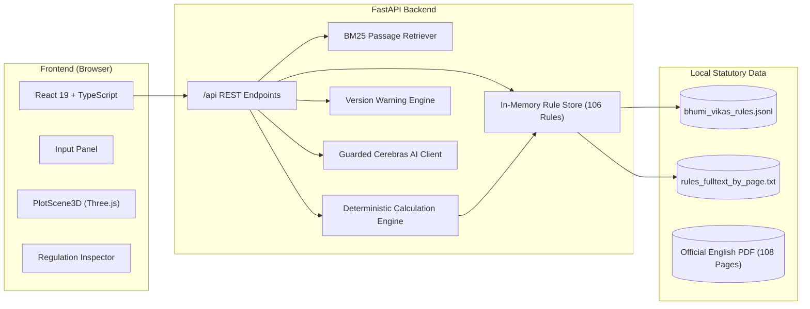

# NIYAMLENS

> **See the Rule. Understand Its Impact.**

[](LICENSE)
[](https://www.python.org/)
[](https://fastapi.tiangolo.com/)
[](https://react.dev/)
[](https://docs.pmnd.rs/react-three-fiber)
[](docs/TESTING.md)

**NIYAMLENS** is an AI-assisted regulatory intelligence and spatial visualization platform engineered for building-permission clerks at the **Bhopal Municipal Corporation**. It transforms the dense, 108-page *Madhya Pradesh Bhumi Vikas Rules, 2012* into verifiable, evidence-backed answers accompanied by exact legal citations, deterministic calculations, and interactive 3D spatial plot constraints.

---

## The Problem

Every citizen constructing a home, shop, or commercial addition in Bhopal must comply with the *M.P. Bhumi Vikas Rules, 2012*. However:
* **Complex Tabular Regulations:** Critical numbers (setbacks, height limits, fees) sit in multi-bracket tables spread across 108 pages and 105 numbered rules.
* **Counter Queues & Delay:** Clerks at the municipal counter must answer repeated questions under severe time constraints. Manually locating the governing rule takes minutes and risks misreading tables.
* **Costly Errors:** Citizens often learn about a violation—such as an inadequate front setback—only after spending money preparing blueprints and paying application fees.
* **Outdated Sources & Amendments:** The state's consolidated rulebook ends at March 6, 2025. Crucial amendments (such as the August 28, 2026 change to Rule 2(5)(c) for plots up to 500 sq m) are absent from consolidated copies.
* **Language & Font Hurdles:** Citizens ask questions in Hindi and English, but the official consolidated Hindi PDF uses a non-Unicode legacy font that extracts as corrupted text.

---

## Our Solution

NIYAMLENS connects a citizen's question to verified statutory law and practical 3D geometry:

1. **Ask in English or Hindi:** The clerk enters the citizen's question (e.g., *"My plot is 200 sq m on a 9 m road. What front setback do I need?"*).
2. **Instant Statutory Retrieval:** The in-memory retrieval engine locates the exact governing provision (Rule 56, Table 4, PDF page 77) with verbatim text excerpts.
3. **Deterministic Math:** Calculations (setbacks, permission fees, electric line safety clearances) are executed in pure Python code—never by a hallucinating language model.
4. **Interactive Spatial Visualization:** The **Rule-to-Geometry Engine** renders the plot, road frontage, proposed building volume, and verified setback restriction zones on an interactive 3D canvas.
5. **Honest Uncertainty & Version Warnings:** If details are missing, the system asks for them. If a topic is outside the rules (e.g., property tax), it states `NOT_FOUND`. If an amendment affects the rule, it raises a `VERSION_REVIEW_NEEDED` alert.

---

## What Makes NIYAMLENS Different?

```
┌────────────────────────────────────────────────────────────────────────┐
│                        CONVENTIONAL AI CHATBOT                         │
│  "You probably need around 3 metres setback. (Hallucinated arithmetic) │
└───────────────────────────────────┬────────────────────────────────────┘
                                    ▼
┌────────────────────────────────────────────────────────────────────────┐
│                              NIYAMLENS                                 │
│  ✓ Governing Clause: Rule 56(1)(a), Table 4 (PDF Page 77)             │
│  ✓ Exact Formula: Road width 9m <= 12m -> Front Open Space = 3.0 m     │
│  ✓ Deterministic Code: Python verified against loaded PDF table text   │
│  ✓ Rule-to-Geometry: 3D interactive plot highlights setback zone       │
│  ✓ Traceable: Clicking the 3D zone reveals the statutory clause        │
│  ✓ Counter Receipt: Printable informational receipt for the citizen   │
└────────────────────────────────────────────────────────────────────────┘
```

* **Rule-to-Geometry Engine:** Visualizes abstract legal prose into physical spatial envelopes.
* **Regulation Debugger:** Explicitly labels results as `VERIFIED`, `CALCULATION_COMPLETED`, `MORE_INFORMATION_NEEDED`, `VERSION_REVIEW_NEEDED`, or `NOT_FOUND`.
* **Zero Fabrication:** The system never invents a rule and never guesses arithmetic.
* **Offline AI Fallback:** Operates completely without an external AI connection using pre-verified deterministic templates.

---

## Visual Interface

> *Interface Mockup / Screenshot Placeholder:*  
> `[TODO: Add screenshot or 2-minute demonstration video of the 3-panel clerk interface]`

---

## How It Works



---

## High-Level System Architecture



---

## Feature Overview

### Implemented Features
* **In-Memory Statutory Loader (`backend/app/rules/loader.py`):** Ingests 106 rules, partitions 787 passages, strips running headers, and maps each passage to its exact PDF page.
* **Embedded Rule Detection:** Accurately routes inserted rules (12-A, 17-a, 25(A), 26-A, 42-A, 93(a)) physically located inside parent rule text records.
* **Startup Table Self-Verification (`backend/app/rules/verified_tables.py`):** Automatically cross-checks codified calculation tables against verbatim text at server boot.
* **Deterministic Calculation Engines (`backend/app/calculations/`):**
  - Front, rear, and side setbacks under Rule 56 Table 4.
  - Building permission fees across building use categories under Rule 21.
  - Electric line clearances under Rule 52.
* **Version Warning Engine (`backend/app/rules/version_warnings.py`):** Discloses the March 6, 2025 consolidation limit and flags queries affected by the August 28, 2026 amendment to Rule 2(5)(c).
* **Thresholded BM25 Search & Rejection:** Scores queries and returns `NOT_FOUND` for out-of-scope inquiries (e.g., property tax, land registry prices).
* **Cerebras AI Integration with Guardrails (`backend/app/services/llm.py`):** Synthesizes natural-language explanations with number and citation guardrails, falling back to deterministic templates when offline.
* **3D Rule-to-Geometry Viewport (`frontend/src/features/plot3d/PlotScene3D.tsx`):** Interactive Three.js/React Three Fiber canvas rendering plot boundary, road frontage, proposed volume, and colored setback zones.
* **Automated Test Suite:** 116 passing unit tests in `backend/tests/` and benchmark evaluation script across 17 real municipal counter questions.

### Planned Features (In Progress)
* **Full 3-Panel UI Layout Integration:** Connecting `PlotScene3D.tsx`, `ProjectInputsPanel.tsx`, and Regulation Inspector into the root `App.tsx` layout.
* **Printable Counter Receipt View:** One-click citizen handover receipt export with municipal disclaimer.
* **Expanded Calculations:** Adding commercial FAR and parking spaces under Rule 84 Table 10.

---

## Technology Stack

| Layer | Technologies | Role |
| ----- | ------------ | ---- |
| **Backend** | Python 3.11+, FastAPI 0.118, Pydantic v2, Uvicorn | High-performance REST API and calculation engine |
| **AI Inference** | Cerebras Cloud SDK (`cerebras_cloud_sdk`, `gpt-oss-120b`) | Natural language interpretation and synthesis (optional) |
| **Statutory Data** | In-Memory BM25, JSONL, Page Text Index | Sub-5ms retrieval over 787 legal passages |
| **Frontend** | React 19, TypeScript, Vite, Tailwind CSS v4 | Responsive, accessible clerk user interface |
| **3D Rendering** | Three.js, React Three Fiber (`@react-three/fiber`), Drei | Lightweight Rule-to-Geometry spatial canvas |
| **UI Primitives** | Radix UI, Lucide React, shadcn/ui | High-contrast, accessible UI components |
| **Testing** | Pytest, HTTPX, Vitest | Unit, integration, and benchmark test suites |
| **Deployment** | Docker (Multi-stage), Render Web Service | Single-origin container packaging |

---

## Quick Start in 5 Steps

### Step 1: Clone the Repository
```bash
git clone https://github.com/ut3av/ImpactLab.git
cd ImpactLab
```

### Step 2: Set Up Backend Virtual Environment
```bash
python -m venv .venv
# On Windows (PowerShell):
.venv\Scripts\Activate.ps1
# On Linux / macOS:
source .venv/bin/activate

cd backend
pip install -r requirements.txt
pip install -r requirements-dev.txt
```

### Step 3: Run the Verification Tests
```bash
pytest -q
# Output: 116 passed in 1.86s
```

### Step 4: Configure Environment (Optional)
```bash
cp ../.env.example ../.env
# Edit ../.env if you wish to configure CEREBRAS_API_KEY.
# (If left empty, the application runs fully with verified template answers!)
```

### Step 5: Start the Application Server
```bash
uvicorn app.main:app --reload --port 8000
```
Visit:
* API Health: [http://localhost:8000/api/health](http://localhost:8000/api/health)
* Interactive Swagger Docs: [http://localhost:8000/api/docs](http://localhost:8000/api/docs)

*(To run the React frontend in development mode, open a second terminal, navigate to `frontend/`, run `npm install`, and run `npm run dev`.)*

---

## Benchmark Evaluation: 17 Sample Questions

NIYAMLENS was evaluated against the 17 benchmark questions from `resources/sample_questions.md` using `backend/scripts/eval_samples.py`. Results are logged in `docs/evaluation_results.json`.

```bash
python backend/scripts/eval_samples.py
```

| Category | Questions | Evaluation Performance |
| -------- | --------- | ---------------------- |
| **Deterministic Calculations** | Q1, Q5 | :white_check_mark: Exact setback (3.6m) and electrical clearances (2.5m vert / 1.2m horiz) computed. |
| **Missing Parameter Detection** | Q8, Q10, Q14, Q15 | :white_check_mark: Returned `MORE_INFORMATION_NEEDED`; accurately prompted for height, use, or built-up area. |
| **Version Amendment Alert** | Q11 | :white_check_mark: Returned `VERSION_REVIEW_NEEDED` with `AMENDMENT_2026_RULE_2_5_C` warning. |
| **Out-of-Scope Rejection** | Q16, Q17 | :white_check_mark: Returned `NOT_FOUND` for property tax and land market rates; zero fabricated rules. |
| **General Retrieval** | Q2, Q3, Q4, Q6, Q7, Q9, Q12, Q13 | :white_check_mark: Exact governing rules (Rule 17, 23, 28, 18, 16, 24, 103, 83) cited with PDF pages. |

Detailed benchmark documentation is available in [docs/TESTING.md](docs/TESTING.md).

---

## Important Regulatory Disclaimers & Limitations

1. **Decision Support, Not Legal Advice:** NIYAMLENS is an AI-assisted decision-support prototype. It does not issue official building permits or replace the administrative authority of municipal officers.
2. **Consolidation Cutoff (March 6, 2025):** The official consolidated text bundled with the application ends at March 6, 2025. It does not incorporate the August 28, 2026 amendment to Rule 2(5)(c) or any subsequent gazettes.
3. **Hindi Statutory Precedence:** In statutory construction (*Kurban Hussain v. Indore Municipal Corporation*), the official Hindi gazette text prevails. Because the Hindi PDF uses legacy non-Unicode fonts, NIYAMLENS parses the official English translation and supplies Hindi explanations.

---

## Documentation Navigation

* **[Product Requirements Document (prd.md)](prd.md):** Complete specifications and acceptance criteria.
* **[Architecture Specification](docs/ARCHITECTURE.md):** Detailed system architecture and pipeline diagrams.
* **[Data Sources Guide](docs/DATA_SOURCES.md):** Statutory data inventory, font nuances, and provenance.
* **[Development Guide](docs/DEVELOPMENT.md):** Comprehensive setup, scripts, and troubleshooting.
* **[Testing & Benchmarking](docs/TESTING.md):** Pytest suite breakdown and evaluation matrix.
* **[Deployment Guide](docs/DEPLOYMENT.md):** Docker containerization and cloud hosting.
* **[Architecture Decisions (ADRs)](docs/DECISIONS.md):** Formal records of core technical decisions.
* **[Contributing Guidelines](CONTRIBUTING.md):** Contribution process and rule addition protocol.
* **[Security Policy](SECURITY.md):** Responsible vulnerability disclosure and secret handling.
* **[Changelog](CHANGELOG.md):** Release notes and record of completed work.

---

## Project Attribution & Acknowledgements

* **Hackathon:** Claude Impact Lab × Cerebras Café Compute, Bhopal (11 October 2026).
* **Track:** Track 1: Bhumi Vikas Sahayak.
* **Problem Statements Repository:** [Bhopal Impact Lab 2026 Problem Statements](https://github.com/Vishal4742/bhopal-impact-lab-2026-problem-statements).
* **Statutory Body:** Directorate of Town and Country Planning, Government of Madhya Pradesh.
* **Application Repository:** [https://github.com/ut3av/ImpactLab](https://github.com/ut3av/ImpactLab)
* **Licence:** MIT License for application code (see [LICENSE](LICENSE)). Official statutory PDFs and datasets remain public government works.
