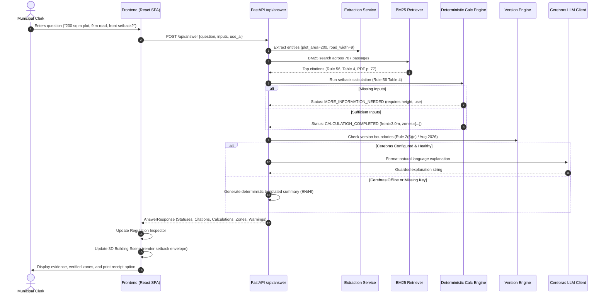

# NIYAMLENS: Technical Architecture

## 1. System Overview

**NIYAMLENS** is an AI-assisted regulatory intelligence and spatial visualization platform designed specifically for building-permission clerks at the Bhopal Municipal Corporation.

Rather than operating as a conventional conversational wrapper over unstructured PDFs, NIYAMLENS implements a **three-tier decoupled architecture**:
1. **Deterministic Rule Ingestion & Self-Verifying Tables:** In-memory rule passage indexing with exact PDF page mapping.
2. **Deterministic Calculation & Geometry Engine:** Pure Python algorithms for tables, setback brackets, permission fees, and spatial boundaries.
3. **Guarded Explanation & Visualization Layer:** An optional Cerebras inference pipeline for natural-language synthesis constrained by strict schema and number guards, coupled with a lightweight React Three Fiber 3D spatial viewport.

---

## 2. High-Level Architecture Diagram

```mermaid
graph TD
    subgraph Client ["Client Browser (Clerk Interface)"]
        UI["React 19 + TypeScript SPA"]
        Form["ProjectInputsPanel (Dimensions, Use, Road)"]
        Scene3D["PlotScene3D (Three.js / React Three Fiber)"]
        Inspector["Regulation Inspector & Citations"]
        Receipt["Counter Receipt Export"]
    end

    subgraph Backend ["FastAPI Application (Port 8000)"]
        API["FastAPI REST Router (/api)"]
        Extract["Parameter Extraction Service"]
        Retriever["BM25 Rule Retriever (787 Passages)"]
        CalcEngine["Deterministic Calculation Engine"]
        Verif["Self-Verifying Tables Layer"]
        VersionWarn["Version Warning Engine"]
        AnswerSvc["Answer Orchestration Service"]
        LLMGuard["Cerebras Client + Strict Guards"]
    end

    subgraph Data ["Local Statutory Corpora"]
        JSONL[("bhumi_vikas_rules.jsonl (106 Rules)")]
        FullText[("bhumi_vikas_rules_fulltext_by_page.txt (108 Pages)")]
        PDF[("MP_Bhumi_Vikas_Rules_2012_EN.pdf")]
    end

    subgraph AI ["External AI Provider (Optional)"]
        Cerebras["Cerebras Cloud API (gpt-oss-120b)"]
    end

    UI -->|HTTP POST /api/answer| API
    UI -->|HTTP POST /api/calculate| API
    UI -->|HTTP GET /api/rules/search| API

    API --> AnswerSvc
    AnswerSvc --> Extract
    AnswerSvc --> Retriever
    AnswerSvc --> CalcEngine
    AnswerSvc --> VersionWarn
    AnswerSvc --> LLMGuard

    Retriever --> JSONL
    Verif --> FullText
    CalcEngine --> Verif

    LLMGuard -.->|Inference Request| Cerebras
    LLMGuard -.->|Offline / Fallback| AnswerSvc

    AnswerSvc -->|AnswerResponse (JSON)| UI
    UI --> Form
    UI --> Scene3D
    UI --> Inspector
    UI --> Receipt
```

---

## 3. Request Flow Diagram



---

## 4. Backend Architecture Details

### 4.1. In-Memory Rule Store (`app.rules.loader`)
* **Data Sources:** Ingests `data/bhumi_vikas_rules.jsonl` (106 rules) and `data/bhumi_vikas_rules_fulltext_by_page.txt` (108 pages) on startup.
* **Passage Chunker:** Uses PDF running headers (e.g., `Rule 56   M.P. Bhumi Vikas Rules, 2012   78`) to detect page boundaries, splits rules into 787 distinct passages, and assigns each passage its true PDF page number.
* **Embedded Rule Detection:** Identifies embedded rules (e.g., Rule 12-A, 17-a, 25(A), 26-A, 42-A, 93(a)) physically located within parent rule blocks.
* **Memory Footprint:** The entire store resides in RAM (< 20 MB), eliminating database latency.

### 4.2. Self-Verifying Tables Layer (`app.rules.verified_tables`)
* **Problem:** Text extracted from PDF tables can suffer from flattened column alignment.
* **Solution:** Before enabling calculations at boot time, the engine checks that codified table values (Rule 56 Table 4, Rule 21 fees, Rule 52 electrical clearances) match verbatim strings in the loaded PDF text. If any check fails, the respective calculation is disabled with an administrative alert.

### 4.3. Deterministic Calculation Engine (`app.calculations`)
* **`setbacks.py`:** Evaluates front, rear, and side open spaces under Rule 56 (Table 4) based on road width, plot size, building height, and use type.
* **`fees.py`:** Calculates building permission fees under Rule 21 across residential, commercial, industrial, and institutional slabs.
* **`electric.py`:** Computes horizontal and vertical safety clearances under Rule 52 for low/medium, high (≤33kV), and extra-high voltage lines.
* **Missing Inputs Detection:** Returns explicit missing fields (e.g., `building_height_m`, `built_up_area_sqm`) with localized user guidance instead of defaulting to assumed values.
* **Geometry Zones Output:** Generates structured `GeometryZone` models (`front`, `rear`, `left`, `right`) with depths and compliance checks.

### 4.4. Parameter Extraction Service (`app.services.extraction`)
* Extracts physical numbers, units (metres, feet, sq m, sq ft, sq yd), storeys, building usages, and voltage classes using bilingual regular expressions.
* Automatically converts non-metric units (feet to metres, sq ft to sq m) to ensure regulatory consistency.

### 4.5. Hybrid BM25 Retrieval Engine (`app.services.retrieval`)
* **Indexing:** BM25 algorithm over 787 passages.
* **Query Expansion:** Includes a domain glossary mapping common Hindi building terms (e.g., *नक्शा*, *अनुमति*, *सड़क*, *ऊंचाई*) to English statutory vocabulary.
* **Direct Match Heuristic:** Directly routes explicit queries like *"Rule 56"* or *"Rule 23"* to the corresponding rule records.
* **Relevance Guard (`MIN_SCORE = 9.0`):** Queries scoring below threshold (e.g., property tax, land registry prices) are categorized as `NOT_FOUND` rather than producing irrelevant rule matches.

### 4.6. Version Warning Engine (`app.rules.version_warnings`)
* Detects questions relating to development permission for plots up to 500 sq m and attaches the `AMENDMENT_2026_RULE_2_5_C` warning, highlighting that the March 6, 2025 consolidated copy does not include the August 28, 2026 amendment.
* Attaches `HINDI_TEXT_PREVAILS` for Hindi queries to reflect statutory translation precedence.

### 4.7. Guarded LLM Explanation Service (`app.services.llm`)
* Uses `cerebras_cloud_sdk` (`gpt-oss-120b`) for rapid text synthesis.
* **Strict Guardrails:**
  - Enforces JSON structured outputs.
  - Verifies that any rule number mentioned in the generated text exists in the retrieved citations.
  - Verifies that any numbers appearing in the explanation match the deterministic calculation output.
  - Automatically falls back to deterministic template responses if Cerebras is unconfigured, times out (> 20s), or violates guardrails.

---

## 5. Frontend Architecture Details

The client application is built with **React 19**, **TypeScript**, **Vite**, **Tailwind CSS v4**, and **React Three Fiber**.

### 5.1. Component Architecture
* **`PlotScene3D.tsx` (Rule-to-Geometry Viewport):**
  - Uses `@react-three/fiber` and `@react-three/drei` (`Canvas`, `CameraControls`, `Grid`, `Line`, `Edges`).
  - Renders ground plot boundary (`plot_width_m` × `plot_depth_m`), adjacent road frontage, translucent colored restriction zones (Front: Blue, Rear: Orange, Sides: Purple), and proposed building volume.
  - Interactive selection: Clicking any setback zone fires a callback linking to the governing regulation in the inspector.
  - Features camera presets: Perspective/Isometric, Top-Down (2D Plan), and Front View.
  - Supports `reducedMotion` and low-power rendering (`frameloop="demand"`).
* **`ProjectInputsPanel.tsx` (Parameter Control):**
  - Controlled form for plot dimensions, road width, building height, storeys, usage category, and voltage class.
  - Highlights missing inputs flagged by the backend.
* **`StatusBadge.tsx`:**
  - Renders visual badges for Regulation Debugger statuses (`VERIFIED`, `CALCULATION_COMPLETED`, `SOURCE_FOUND`, `MORE_INFORMATION_NEEDED`, `NOT_FOUND`, `VERSION_REVIEW_NEEDED`).
* **`Counter Receipt` (Planned UI Assembly):**
  - Formatted printable summary card detailing clerk query, verified rule citations, calculation breakdown, and disclaimer for citizen counter handover.

---

## 6. Implementation Status Matrix

| Component | Architecture Status | Implementation Details |
| --------- | ------------------- | ---------------------- |
| **Rule Loader & Chunker** | **Implemented** | `loader.py`: 106 rules, 787 passages, 108 pages. Tested with 116 tests. |
| **Self-Verifying Tables** | **Implemented** | `verified_tables.py`: Rules 56, 21, 52, 42, 2(38). |
| **Setback Calculations** | **Implemented** | `calculations/setbacks.py`: Rule 56 Table 4. |
| **Fee Calculations** | **Implemented** | `calculations/fees.py`: Rule 21 schedule. |
| **Electrical Clearances** | **Implemented** | `calculations/electric.py`: Rule 52. |
| **Version Warning System** | **Implemented** | `version_warnings.py`: Rule 2(5)(c) Aug 2026 alert. |
| **BM25 Retrieval & Glossary** | **Implemented** | `retrieval.py`: Thresholded search, NOT_FOUND handling. |
| **Cerebras LLM Client** | **Implemented** | `llm.py`: Guardrails, timeout, template fallback. |
| **FastAPI REST API** | **Implemented** | `routes.py`: 6 endpoints with Pydantic validation. |
| **3D Scene Component** | **Implemented** | `PlotScene3D.tsx`: Interactive R3F canvas with zones & camera. |
| **Input Panel Component** | **Implemented** | `ProjectInputsPanel.tsx`: Parameter input interface. |
| **Frontend UI Assembly** | **Partially Implemented** | Individual components built; root `App.tsx` requires final 3-panel assembly. |
| **Counter Receipt Export** | **Partially Implemented** | Data structures complete; print layout ready for frontend integration. |

---

## 7. Deployment Topology

NIYAMLENS is designed for a **Single-Origin Monolithic Container**:
1. **Build Stage:** Node.js container builds the Vite React application (`npm run build`), generating static assets in `frontend/dist`.
2. **Runtime Stage:** Lightweight Python 3.11 container mounts `frontend/dist` at the root (`/`) while exposing the REST API under `/api`.
3. **No External Database:** Eliminates PostgreSQL/Redis operational overhead; boots in < 3 seconds.
