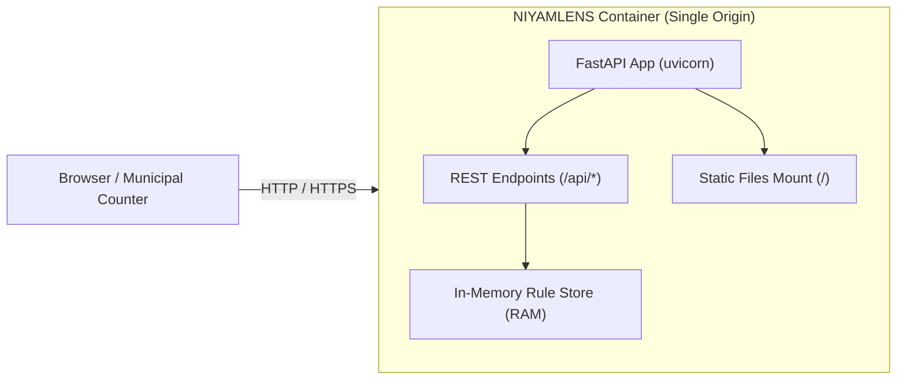

# NIYAMLENS: Deployment Guide

This guide details the deployment architecture, containerization, and configuration options for **NIYAMLENS**.

---

## 1. Deployment Topology

NIYAMLENS is packaged as a **single-origin monolithic container**. This architecture eliminates cross-origin resource sharing (CORS) complications, avoids multi-container orchestration overhead, and ensures the entire application runs with sub-3-second startup times.



* **Frontend:** The React 19 application is compiled into static production assets (`frontend/dist/`).
* **Backend:** FastAPI serves the JSON API under `/api/*` and serves the compiled Single Page Application from `frontend/dist/` at the root path (`/`). Any non-API route falls back to `index.html`.
* **State / Storage:** Stateless and self-contained; statutory datasets (`data/`) are packaged directly into the container image.

---

## 2. Docker Packaging

### 2.1. Multi-Stage Dockerfile Specification
The root `Dockerfile` utilizes a two-stage build to produce a minimal, secure production image:

```dockerfile
# Stage 1: Build the React frontend
FROM node:20-slim AS frontend-builder
WORKDIR /build
COPY frontend/package*.json ./
RUN npm ci
COPY frontend/ ./
RUN npm run build

# Stage 2: Production Python runtime
FROM python:3.11-slim
WORKDIR /app

# Prevent Python from writing .pyc files and buffer stdout
ENV PYTHONDONTWRITEBYTECODE=1
ENV PYTHONUNBUFFERED=1

# Install backend dependencies
COPY backend/requirements.txt ./
RUN pip install --no-cache-dir -r requirements.txt

# Copy backend application code and datasets
COPY backend/app ./app
COPY data/ ./data
COPY resources/ ./resources

# Copy compiled frontend from Stage 1 into frontend/dist
COPY --from=frontend-builder /build/dist ./frontend/dist

# Expose default HTTP port
EXPOSE 8000

# Set dynamic port via environment variable (Render compatible)
CMD ["sh", "-c", "uvicorn app.main:app --host 0.0.0.0 --port ${PORT:-8000}"]
```

### 2.2. Building the Docker Image Locally
From the repository root:

```bash
docker build -t niyamlens:latest .
```

### 2.3. Running the Docker Container Locally
```bash
docker run -p 8000:8000 \
  -e CEREBRAS_API_KEY="your-api-key-here" \
  -e PORT=8000 \
  niyamlens:latest
```

Visit [http://localhost:8000](http://localhost:8000) to access the application.

---

## 3. Environment Variables Reference

| Variable | Type | Default | Description |
| -------- | ---- | ------- | ----------- |
| `PORT` | Integer | `8000` | Port on which Uvicorn binds HTTP requests. Assigned dynamically by cloud hosts like Render. |
| `CEREBRAS_API_KEY` | String (Secret) | *None* | Optional API key for Cerebras Cloud inference. If omitted, the app operates fully with deterministic templates. |
| `CEREBRAS_MODEL` | String | `gpt-oss-120b` | Model identifier used for natural language explanation generation. |
| `CEREBRAS_TIMEOUT_S` | Float | `20.0` | Maximum wait time in seconds before abandoning live AI and using template answers. |

---

## 4. Production Health Checks

The backend provides a dedicated health check endpoint:

```http
GET /api/health
```

### Expected JSON Response (Status 200 OK):
```json
{
  "status": "ok",
  "rules_loaded": 106,
  "passages_indexed": 787,
  "pages_loaded": 108,
  "verified_sources": {
    "ok": 5,
    "total": 5
  },
  "ai_configured": false,
  "frontend_built": true
}
```
If the statutory data cannot be read, the endpoint returns `"status": "degraded"` with HTTP 503.

---

## 5. Deploying to Cloud Platforms (Render / Railway / Fly.io)

### Deploying on Render (Web Service)
1. Fork or push your code to GitHub.
2. In the [Render Dashboard](https://dashboard.render.com), create a new **Web Service**.
3. Select your repository: `https://github.com/ut3av/ImpactLab`.
4. Choose **Docker** as the Runtime environment.
5. In the Environment Variables settings, configure:
   - `CEREBRAS_API_KEY` (optional secret)
   - `CEREBRAS_MODEL`: `gpt-oss-120b`
   - `PORT`: Automatically set by Render.
6. Click **Create Web Service**. Render will automatically build the multi-stage image and deploy.

---

## 6. Current Deployment Status

* **Local Containerization:** The multi-stage Docker packaging and single-origin serving pipeline are defined and tested.
* **Public Cloud Deployment:** A live public deployment URL has not yet been provisioned for this repository. Maintainers should follow Section 5 to deploy to Render when ready.
