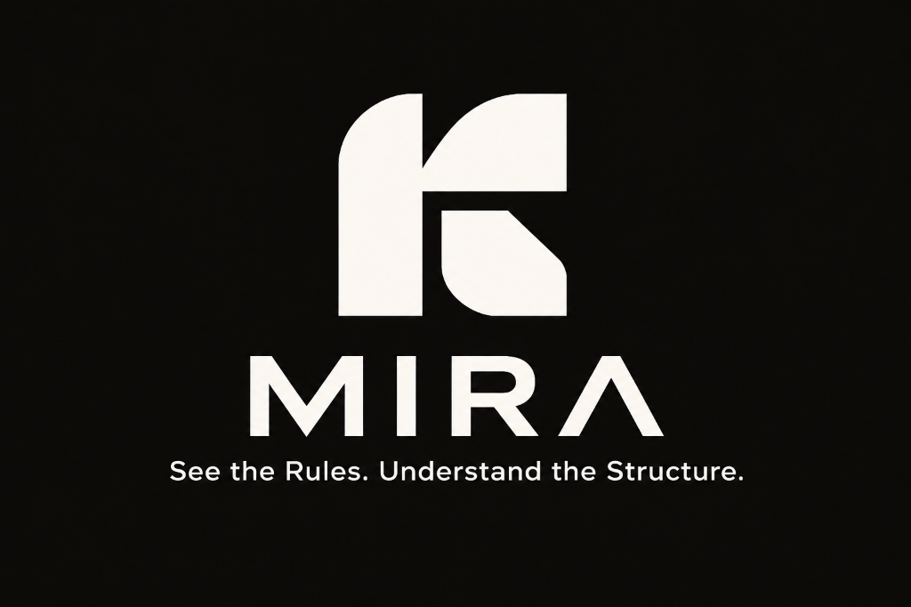

<p align="center">
  
</p>

# MIRA: Product Requirements Document (PRD)

**Product:** MIRA  
**Tagline:** See the Rules. Understand the Structure.  
**Category:** AI-Assisted Regulatory Intelligence & Spatial Decision Support  
**Target User:** Building-Permission Clerk, Bhopal Municipal Corporation  
**Platform:** Responsive Web Application (Single-Page Application + REST API)  
**Primary Languages:** English and Hindi  
**AI Inference:** Cerebras API (`gpt-oss-120b`), optional with deterministic fallback  
**Project Context:** Claude Impact Lab × Cerebras Café Compute, Bhopal (Track 1: Bhumi Vikas Sahayak)  
**Document Version:** 1.0  
**Status:** In Active Prototype Development  

---

## 1. Product Vision & Philosophy

**MIRA** is an evidence-backed regulatory intelligence platform that empowers municipal building-permission clerks to find, understand, verify, and visually communicate building regulations from the *Madhya Pradesh Bhumi Vikas Rules, 2012*.

Unlike generic chatbots that summarize documents into unverifiable conversational text, MIRA grounds every statement in authentic statutory provisions, executes calculations deterministically in code, and translates spatial rules into interactive 3D geometry via the **Rule-to-Geometry Engine**.

**Core Philosophy:** *A language model may explain a rule, but code must calculate the numbers, citations must prove the law, and geometry must visualize the physical impact.*

---

## 2. Problem Statement & User Context

### 2.1. The Operational Reality
Every house, shop, or commercial expansion in Bhopal must comply with the *M.P. Bhumi Vikas Rules, 2012*. This statutory document spans 108 pages and 105 numbered rules (plus Rule 26-B). 

At the Bhopal Municipal Corporation building-permission counter:
* Citizens arrive asking urgent questions: *"My plot is 200 sq m on a 9 m road. What front setback do I need, how many floors can I build, and what fee must I pay?"*
* Clerks must cross-reference complex, flattened tables across disparate chapters within 60 seconds.
* Misinterpreting tables leads to citizen frustration, rejected plans, and wasted fees.
* Consolidated copies stop at March 6, 2025, leaving clerks vulnerable to recent legal changes (e.g., the August 28, 2026 amendment to Rule 2(5)(c)).
* Citizens frequently communicate in Hindi, while the official Hindi PDF suffers from legacy font encoding corruption that cannot be machine-parsed safely.

### 2.2. The Primary User
* **Primary Persona:** Building-Permission Counter Clerk, Bhopal Municipal Corporation.
* **User Need:** Rapid, verifiable answers backed by exact rule numbers and PDF page references, automated fee/setback calculations, spatial visualizations to explain constraints to citizens, and informational counter receipts.
* **Operational Scope:** Decision support only. MIRA informs the clerk; the clerk makes the official determination.

---

## 3. Product Goals & Non-Goals

### 3.1. Goals
1. **Source Grounding:** 100% of substantive answers must cite the governing Rule number, PDF page, and exact statutory passage.
2. **Zero Calculation Hallucination:** Setbacks, fees, and clearances must be evaluated via deterministic Python code, never by language model arithmetic.
3. **Honest Uncertainty:** Clearly return `NOT_FOUND` when queries fall outside the rulebook (e.g., property tax, market land rates) and `MORE_INFORMATION_NEEDED` when parameters are missing.
4. **Version Transparency:** Proactively warn clerks when queries touch provisions amended after the March 6, 2025 consolidation date.
5. **Spatial Comprehension:** Visually illustrate verified setback restrictions on an interactive 3D plot.
6. **Bilingual Usability:** Fully support natural-language inquiries in English and Hindi.
7. **Offline Resilience:** Operate seamlessly without an active Cerebras API connection.

### 3.2. Non-Goals
* **Not an Official Sanctioning Portal:** MIRA does not issue legal permits or replace statutory discretion.
* **Not a Citizen Tax/Revenue Portal:** Excludes property tax payments, utility bills, or land registry lookups.
* **Not a Full Architectural CAD Tool:** Does not generate building blueprints or replace CAD software.
* **No Live Government Integrations:** Does not interface with live state portals or store citizen identity data.

---

## 4. Unique Product Differentiators

| Capability | Generic RAG Chatbot | MIRA |
| ---------- | ------------------- | --------- |
| **Numerical Calculations** | LLM guesses numbers; frequently misreads tabular brackets. | **Deterministic Code:** Python functions calculate exact values from codified tables. |
| **Spatial Understanding** | Text descriptions only (e.g., "leave 3m front space"). | **Rule-to-Geometry Engine:** 3D interactive plot rendering verified restriction zones. |
| **Out-of-Scope Topics** | Hallucinates plausible answers for property tax or land rates. | **Regulation Debugger:** Strictly rejects out-of-scope topics with `NOT_FOUND`. |
| **Statutory Amendments** | Blindly answers from outdated consolidated PDFs. | **Version Review System:** Flags provisions amended after March 2025 (e.g., Aug 2026). |
| **AI Availability** | Hard dependency; crashes if API key is absent or rate-limited. | **Graceful Offline Fallback:** Operates with verified deterministic templates. |
| **Citizen Handover** | Chat transcript. | **Counter Receipt:** Clean, printable informational receipt with citations and disclaimers. |

---

## 5. User Workflow & Journey

```text
[1. Ask]        Citizen asks query in English or Hindi at BMC counter.
                 │
[2. Extract]    System extracts plot area, road width, height, storeys, usage.
                 │
[3. Retrieve]   BM25 searches 787 passages; checks relevance threshold (MIN_SCORE=9.0).
                 │
[4. Verify]     Determines rule applicability and checks if all inputs are present.
                 │
[5. Calculate]  Deterministic functions compute setbacks, fees, or clearances.
                 │
[6. Explain]    Synthesizes answer (via Cerebras AI with guardrails, or template fallback).
                 │
[7. Visualise]  Rule-to-Geometry Engine renders 3D setback zones on the plot.
                 │
[8. Inspect]    Clerk clicks visual zone to view exact statutory passage in inspector.
                 │
[9. Export]     Clerk prints/downloads Counter Receipt for citizen handover.
```

---

## 6. Functional Requirements (FR)

| ID | Requirement | Priority | Implementation Status |
| -- | ----------- | -------- | --------------------- |
| **FR-01** | Accept natural-language regulatory questions in English and Hindi. | Must Have | **Implemented** (Bilingual extraction & glossary expansion in `services/extraction.py`) |
| **FR-02** | Retrieve relevant statutory passages from the 106 rules in `bhumi_vikas_rules.jsonl`. | Must Have | **Implemented** (In-memory BM25 retriever in `services/retrieval.py`) |
| **FR-03** | Display exact rule number, PDF page number, and verbatim statutory passage. | Must Have | **Implemented** (`models/schemas.py` and `services/answer.py`) |
| **FR-04** | Explicitly return `NOT_FOUND` for queries outside the *M.P. Bhumi Vikas Rules, 2012*. | Must Have | **Implemented** (Threshold guard in `services/retrieval.py`; tested on Q16, Q17) |
| **FR-05** | Identify missing parameters required to apply a rule and return `MORE_INFORMATION_NEEDED`. | Must Have | **Implemented** (Structured missing input detection in `calculations/common.py`) |
| **FR-06** | Execute deterministic numerical calculations for setbacks (Rule 56 Table 4), fees (Rule 21), and electric clearances (Rule 52). | Must Have | **Implemented** (`calculations/setbacks.py`, `fees.py`, `electric.py`) |
| **FR-07** | Flag provisions amended after March 6, 2025 (e.g., August 28, 2026 amendment to Rule 2(5)(c)) with `VERSION_REVIEW_NEEDED`. | Must Have | **Implemented** (`rules/version_warnings.py`; tested on Q11) |
| **FR-08** | Render an interactive 3D plot with plot boundary, road frontage, and proposed volume. | Should Have | **Implemented** (`frontend/src/features/plot3d/PlotScene3D.tsx`) |
| **FR-09** | Display verified setback zones on 3D canvas and connect selection to statutory evidence. | Should Have | **Implemented** (Zone meshes & click events in `PlotScene3D.tsx`) |
| **FR-10** | Dynamically update 3D plot geometry when plot parameters change. | Should Have | **Implemented** (`PlotScene3D.tsx` props reactivity) |
| **FR-11** | Generate a printable/downloadable Counter Receipt summarizing query, citations, and calculations. | Should Have | **Partially Implemented** (Backend models ready; print view planned in UI) |
| **FR-12** | Operate fully without a Cerebras API key or during network downtime using template answers. | Must Have | **Implemented** (`services/llm.py` fallback pipeline) |
| **FR-13** | Automated test suite verifying rules, calculations, and the 17 Track 1 sample questions. | Must Have | **Implemented** (116 Pytest tests + `scripts/eval_samples.py`) |
| **FR-14** | Single-container Docker packaging and Render-compatible deployment configuration. | Must Have | **Implemented** (Multi-stage `Dockerfile` and documentation) |

---

## 7. Regulation Debugger Status Specifications

The Regulation Debugger communicates result fidelity using explicit, verified states:

* **`VERIFIED`**: The statutory rule and all required physical parameters have been fully established, and results match verified tables.
* **`CALCULATION_COMPLETED`**: A numerical value (setback depth, permission fee, clearance distance) has been computed via deterministic code.
* **`SOURCE_FOUND`**: Applicable statutory passages have been located and displayed, but specific case math has not been evaluated.
* **`MORE_INFORMATION_NEEDED`**: The rule has been identified, but required parameters (e.g., building height, usage, built-up area) are missing.
* **`NOT_FOUND`**: The query topic falls outside the *M.P. Bhumi Vikas Rules, 2012*.
* **`VERSION_REVIEW_NEEDED`**: The provision has been amended after the March 6, 2025 consolidation date and requires verification against newer official gazettes.
* **`ILLUSTRATIVE_ONLY`**: Displayed 3D geometry is explanatory and does not constitute approved architectural compliance.

---

## 8. Non-Functional Requirements (NFR)

* **NFR-01 (Accuracy):** 100% of displayed citations must correspond to real entries in the 106 rule records. LLMs are prohibited from inventing citations.
* **NFR-02 (Performance):** In-memory retrieval and deterministic calculation must return in under 100 milliseconds. Total response time with Cerebras inference must not exceed 2.5 seconds.
* **NFR-03 (Security):** Zero client-side API keys. Server limits request payloads to 32 KB (`MAX_BODY_BYTES = 32_000`) and enforces strict Pydantic bounds.
* **NFR-04 (Privacy):** No citizen PII (names, Aadhaar numbers, phone numbers) is collected, stored, or required.
* **NFR-05 (Accessibility):** 3D scene supports reduced-motion preferences (`frameloop="demand"`), and text meets contrast guidelines.
* **NFR-06 (Portability):** Runs locally on Windows, macOS, or Linux, and builds as a standalone container without external database dependencies.

---

## 9. Acceptance Criteria for MVP

1. **Retrieval Benchmark:** All 17 Track 1 sample questions execute successfully via `scripts/eval_samples.py`:
   - Q1 and Q5 produce verified calculations (`CALCULATION_COMPLETED`).
   - Q8, Q10, Q14, and Q15 flag `MORE_INFORMATION_NEEDED` with identified missing fields.
   - Q11 flags `VERSION_REVIEW_NEEDED` with `AMENDMENT_2026_RULE_2_5_C`.
   - Q16 and Q17 produce `NOT_FOUND` with no fabricated rules.
2. **Deterministic Integrity:** Calculations match PDF table numbers exactly (verified by 116 automated tests).
3. **Resilience:** When `CEREBRAS_API_KEY` is omitted, the API responds with HTTP 200 and formatted template answers.
4. **Spatial Demonstration:** Plot dimensions and setback zones render accurately in `PlotScene3D.tsx`.
5. **Transparency:** Every response exposes its verification status and source metadata.

---

## 10. Future Roadmap (Post-MVP)

* **Phase 2 (Architectural Features):** Additional calculations for parking spaces (Rule 84 Table 10) and FAR limits across commercial and mixed-use zones.
* **Phase 3 (Hybrid Search):** Dense neural embeddings paired with BM25 for advanced conceptual retrieval.
* **Phase 4 (Citizen Export):** Direct PDF generation for the Counter Receipt with QR code verification linking back to official gazette notices.
